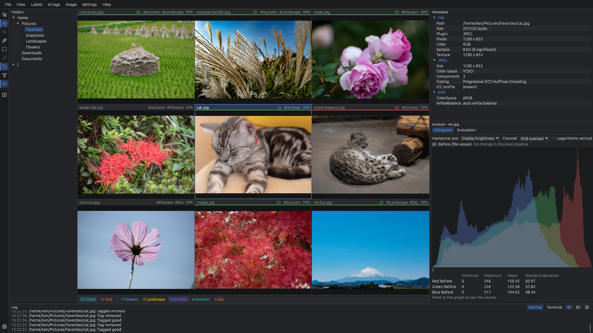
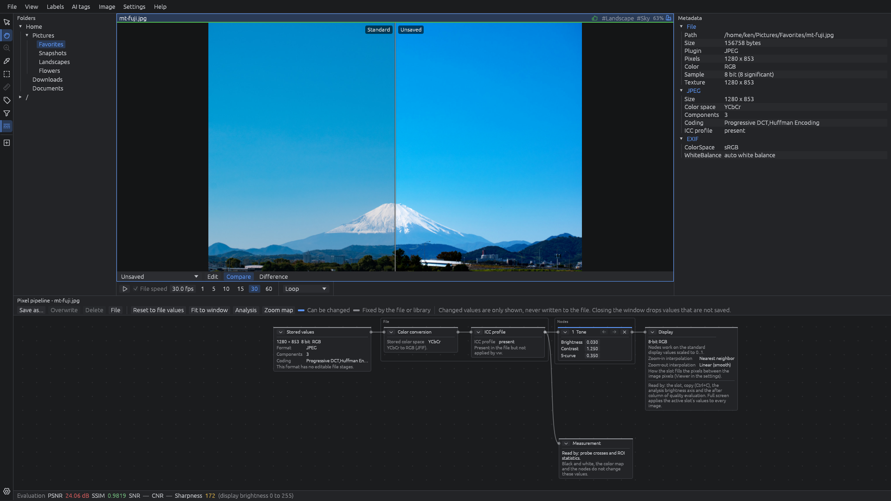
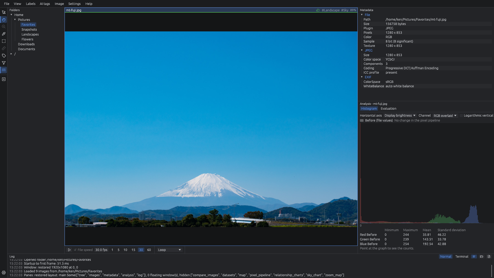

# vw Image Viewer

**vw Image Viewer**（以下 vw）は、Linux と Windows で動く、起動と表示がとても速い画像ビューワです。
たくさんの画像を **すばやく見て**、**キー 1 つで選り分けて**、**中身で探せるようにしまっておく** ための道具です。

紹介ページ: https://xex-ken-xex.github.io/vw/ ・ 詳しい使い方: [使い方のページ](https://xex-ken-xex.github.io/vw/manual/)

- **速い**: 起動してすぐ使えます。読み込みは裏で並行して行い、表示は GPU で描きます。数千枚のフォルダでも待たされません
- **元の画像を書き換えない**: タグやカタログは別のファイルにしまい、画像には一切手を加えません
- **値を落とさない**: 16bit の画像も 8bit に落とさずに読み、画素の値・計測・書き出しは元の階調のまま扱います
- **無料・オープンソース**: MIT / Apache-2.0。メニューは日本語と英語です

## 1. どの画像でもできる整理

JPEG・PNG・WebP・GIF・TIFF・BMP、ZIP / 7z / tar の中の画像まで、同じ操作で見て、選んで、探せます。

- **並べて見比べる**: フォルダの画像を何枚も並べ、ダブルクリックで 1 枚を大きく、ホイールで送り、スライドショーで流します。フォルダに増えた画像は自動で表示します
- **キー 1 つで選り分ける**: ↑ ↓ で「良い / 悪い」、数字キーで自分のタグ（山・海・花など）。付けたもので絞り込み、別のフォルダへコピーしたり、CSV / JSONL に書き出したり、悪い画像をまとめてごみ箱へ送ったりします。ドラッグで動かしてもラベルは付いてきます
- **似た画像から 1 枚を残す**: 撮り直しや連写を組にして、いちばんくっきりした 1 枚に星を付けます。Shift+↑ でそれを残し、ほかを「悪い」にします
- **AI に任せる**: 写っているもののタグと、人の顔の名前を付けます。モデルは PC の中で動き、画像を外へ送りません
- **中身で探す**: フォルダを「データセット」として登録すると、撮影情報・PNG のテキスト・TIFF のタグなどを ZIP の中まで集めた **検索カタログ** を作ります。「ISO 800 以上」のように中身で探し、見つけた画像だけを取り出せます
- **地図で探す**: GPS のある写真を地図に点で出し、地名で探します。位置のない写真は地図に置いて撮影地点を付けられます
- **確かめる**: 画素の値・ROI・ヒストグラム・画質の値（PSNR・SSIM など）を測り、白飛びやピントを確かめます。QR コードも読めます

**画素の変換**: ファイルから表示までの変換をノードで見て、明るさ・曲線・色の表などを変え、元の画像と左右に並べたり差を出したりして比べます。同じ変換はコマンド `vwbatch` でまとめてかけて書き出せます。

## 2. RAW 画像でできること

Nikon・Sony・富士フイルムを中心に、Canon や DNG も読めます。

- **待たずに見る**: 開くとすぐカメラの埋め込みプレビューを出し、裏でセンサーのデータから現像して精細な画像に差し替えます
- **カメラの JPEG と見比べる**: **J** キーで埋め込みの JPEG と vw の現像を切り替えます。同じ名前の JPEG とは自動で組になり、位置を合わせて違いを測れます
- **露出を確かめる**: 現像前のセンサーの値のヒストグラムを、白レベルから何 EV 下かの目盛りで出し、白飛びした割合と余裕（EV）を示します。カメラの JPEG の味付けに左右されません
- **連写から選ぶ**: 撮影日時の近い連写を組にして、残す候補を示します
- **まとめて現像する**: `vwbatch` で、決めた画素の変換をかけて RAW をまとめて書き出せます

## 3. FITS 画像でできること

天体の画像（`.fits` `.fit` `.fts`、圧縮の `.fz`、`.fits.gz`）を、8〜64bit の値のまま扱います。

- **暗い画像を見やすく**: zscale・asinh・対数などで伸ばし、色の表とゲージを付けます。Bayer のカラーカメラの画像はカラーにします
- **下ごしらえ**: 近くにあるダーク・フラット・バイアスのマスターを当ててから表示します
- **サブフレームを選ぶ**: 一晩の画像を評価して悪いものに印を付け、位置を合わせて切り替えて見比べます
- **色を合成する**: 白黒の画像 2〜3 枚を WCS で位置合わせして、R・G・B に当てます
- **仕上げる**: 自動で明るく見せる・GHS・ノイズ除去・デコンボリューション・星の除去と星の戻し
- **空のどこかを知る**: 写した範囲を星図に出します
- **ヘッダで探す**: ヘッダの全項目が検索カタログに入り、「この望遠鏡で撮った」「このフィルター」で探せます。キューブや電波望遠鏡の画像も開けます

## ダウンロード

[Releases](https://github.com/xex-ken-xex/vw/releases) から正式版（vX.Y.Z）をダウンロードします。

| ファイル | 対象 | 使い方 |
| --- | --- | --- |
| `vw-windows-x64.zip` | Windows 10 / 11（64bit） | 展開して `vw.exe` をダブルクリック。警告が出たら **詳細情報** → **実行** |
| `vw-linux-x64.tar.gz` | Ubuntu 22.04 以降など | `tar xzf vw-linux-x64.tar.gz && cd vw && ./install.sh` |

止められたときの対処、画像の開き方、最初の操作は [はじめる](https://xex-ken-xex.github.io/vw/manual/start.html) にあります。

## 使い方

やりたいことごとに、[使い方のページ](https://xex-ken-xex.github.io/vw/manual/) にまとめてあります。

[はじめる](https://xex-ken-xex.github.io/vw/manual/start.html) ・ [画像を見る](https://xex-ken-xex.github.io/vw/manual/view.html) ・ [写真を選り分ける](https://xex-ken-xex.github.io/vw/manual/sort.html) ・ [RAW で撮った写真](https://xex-ken-xex.github.io/vw/manual/raw.html) ・ [画像を探す・しまう](https://xex-ken-xex.github.io/vw/manual/find.html) ・ [天体写真（FITS）](https://xex-ken-xex.github.io/vw/manual/astro.html) ・ [測る・確かめる](https://xex-ken-xex.github.io/vw/manual/check.html) ・ [設定とキーの一覧](https://xex-ken-xex.github.io/vw/manual/reference.html) ・ [よくある質問](https://xex-ken-xex.github.io/vw/manual/faq.html)

不具合は [Issue](https://github.com/xex-ken-xex/vw/issues/new/choose) で知らせてください。修正の提案は [CONTRIBUTING.md](CONTRIBUTING.md)、脆弱性は [SECURITY.md](SECURITY.md) の方法でお願いします。

## 免責事項

vw は現状のまま提供され、いかなる保証もありません。作者と貢献者は、vw を使ったこと、または使えなかったことによって生じたいかなる損害（データの消失を含みます）にも責任を負いません。
vw は画像そのものを書き換えませんが、移動・コピー・ごみ箱へ送る・取り出しは指示どおりにファイルを動かします。大事な画像は別の場所にも残してください。表示や計測の値は確かめるための目安です。

## ライセンス

Copyright (c) 2026 vw contributors（作者: xex、GitHub: [xex-ken-xex](https://github.com/xex-ken-xex)）

[MIT License](LICENSE-MIT) と [Apache License 2.0](LICENSE-APACHE) のどちらかを選んで使えます（`MIT OR Apache-2.0`）。無償で、改変・再配布・商用利用ができます。

- 地名のデータは [GeoNames](https://www.geonames.org/)（[CC BY 4.0](https://creativecommons.org/licenses/by/4.0/)）から必要な列を抜き出したものです（作り方: [tools/geodata/make_geodata.py](tools/geodata/make_geodata.py)）。地図の絵は © [OpenStreetMap](https://www.openstreetmap.org/copyright) contributors です
- AI のモデルは配布物に入っておらず、使う人が選んだときに公開元から取ってきます。ライセンスは [AI タグと顔](https://xex-ken-xex.github.io/vw/manual/sort.html#ai-タグと顔) にあります
- ほかのソフトウェアのライセンスは、配布物の `THIRD-PARTY-LICENSES.txt`（「ヘルプ」→「vw Image Viewer について」からも開けます）にまとめてあります
