# vw

**vw** は、Linux と Windows で動く、起動と表示がとても速い画像ビューワです。
たくさんの画像を **見て**、**選り分けて**、**探せるようにしまっておく** ための道具です。

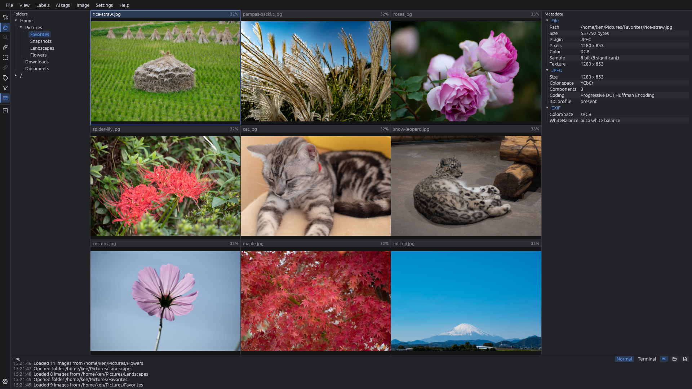

紹介ページ: https://xex-ken-xex.github.io/vw/

vw でできることは、大きく分けて 3 つです。

| | できること | こんなときに |
| --- | --- | --- |
| 🖼️ | **[画像を見る](#1-画像を見る)**<br>フォルダの画像を何枚も並べて、すばやく見比べる。拡大・縮小・スライドショー・アニメーションの再生も | 撮った写真をざっと見たい。似た写真を並べて比べたい。数千枚のフォルダでも待たされたくない |
| 🏷️ | **[タグを付ける](#2-タグを付ける)**<br>画像に「良い / 悪い」のフラグと、自分で決めたタグ（例: 山・海・花）をキー 1 つで付ける。付けたもので絞り込み、別のフォルダへコピーしたり、一覧（CSV / JSONL）に書き出したりする | 良い写真だけを選んで残したい。失敗した写真をまとめて消したい。画像を種類ごとに分けたい（機械学習の学習データ作りなど） |
| 🗂️ | **[カタログで管理する](#3-カタログで管理する)**<br>フォルダを「データセット」として登録すると、中の画像の撮影情報などを集めた **検索カタログ** を作る。どこに何があるかを、名前・メモ・タグ・撮影情報で探し、必要なものを取り出す | 何年分もの画像のどこに何があるか分からない。「ISO 800 以上で撮った写真が入っているフォルダ」のように中身で探したい |

ほかにも、次のような特長があります。

- **速い**: 起動してすぐ使えます。画像の読み込みは裏で並行して行い、表示は GPU で描きます
- **画質を落とさない**: 16bit の画像も 8bit に落とさずに読み込みます
- **画像ファイルを書き換えない**: タグやカタログは別のファイルに保存します。元の画像には一切手を加えません
- **ZIP / 7z / tar の中もそのまま見られる**: パスワード付きの ZIP・7z も開けます
- **日本語表示**: メニューや設定を日本語で表示できます（初期設定は英語。[切り替え方](#日本語表示にする)）
- **無料・オープンソース**: MIT / Apache-2.0 のデュアルライセンスです

### 対応している形式

| 形式 | 内容 |
| --- | --- |
| PNG | 1〜16bit、グレー / RGB / アルファ / パレット |
| JPEG | ベースライン / プログレッシブ、グレー / カラー / CMYK。EXIF の向きを反映し、撮影情報を表示 |
| WebP | 非可逆 / 可逆、透過、EXIF の向きと情報。アニメーションは全コマを 1 つのスロットに並べて再生 |
| GIF | 透過。アニメーションは全コマを 1 つのスロットに並べて再生 |
| BMP | 1〜32bit、パレット / RLE / ビットフィールド、上下逆の BMP も |
| カメラ RAW | Nikon NEF / NRW、Sony ARW / SR2 / SRF、富士フイルム RAF（Canon CR2 / CR3、DNG も読めます）。まずカメラが埋め込んだプレビューを表示し、続けて裏でセンサーのデータを現像して、精細な画像に差し替えます |
| ZIP / 7z / tar | 中の画像を、フォルダと同じように開けます。パスワード付き（ZIP は ZipCrypto と AES、7z は AES）も可。tar は圧縮なし・gzip・bzip2・xz・zstd（`.tar.gz` `.tgz` `.tar.bz2` `.tar.xz` `.tar.zst` など）、漫画の `.cbz` `.cb7` `.cbt`、1 ファイルだけを圧縮した `.gz` `.bz2` `.xz` `.zst` も開けます |
| TIFF | 1〜16bit の整数と 32bit の実数、グレー / RGB / アルファ / パレット / CMYK、白黒の FAX 圧縮（CCITT G3 / G4）、LZW / Deflate / PackBits / JPEG 圧縮、タイル、BigTIFF。複数ページは全ページを 1 つのスロットに並べ、ホイールでページを送る（縮小版のページは除く）。向きのタグを反映し、カメラや作成ソフトの情報を表示 |
| FITS（天体の画像） | `.fits` `.fit` `.fts`、tile 圧縮の `.fz`（RICE / GZIP）、全体を gzip した `.fits.gz`。8〜64bit の整数と実数、`BSCALE` / `BZERO`、欠損（`BLANK` と NaN）。データのない Primary の後ろの画像（JWST など）も開きます。キューブや 3 面の画像は 1 つのスロットに並べてホイールで送り、カラーカメラの Bayer のモザイク（`BAYERPAT`）はカラーにします。天体の画像は暗いので、最初の黒と白を 0.5%〜99.5% の画素で決めます（設定の「天体の画像 (FITS)」で zscale などに変えられ、黒と白の間を asinh・対数・平方根の曲線で持ち上げることもできます）。上下は `ROWORDER` に従い、なければファイルの並びのまま（設定で返せます）。全ヘッダをメタデータに出し、データセットの検索にも使えます。写した空の範囲は [星図](#星図で写した範囲を見る) に出ます |

---

## 目次

- [ダウンロードとインストール](#ダウンロードとインストール)
  - [Windows](#windows)
  - [Ubuntu](#ubuntu)
- [はじめの 5 分](#はじめの-5-分)
- [画面の見方](#画面の見方)
- [1. 画像を見る](#1-画像を見る)
- [2. タグを付ける](#2-タグを付ける)
- [3. カタログで管理する](#3-カタログで管理する)
- [設定](#設定)
- [キー操作の一覧](#キー操作の一覧)
- [vw が作るファイル](#vw-が作るファイル)
- [よくある質問と困ったとき](#よくある質問と困ったとき)
- [不具合の報告と要望](#不具合の報告と要望)
- [開発とビルド](#開発とビルド)
- [セキュリティ](#セキュリティ)
- [ライセンス](#ライセンス)

---

## ダウンロードとインストール

[Releases](https://github.com/xex-ken-xex/vw/releases) のページから、使っている OS のファイルをダウンロードします。

| ファイル | 対象 |
| --- | --- |
| `vw-windows-x64.zip` | Windows 10 / 11（64bit） |
| `vw-linux-x64.tar.gz` | Ubuntu 22.04 以降など、x86_64 の Linux |

同じ Release に、DICOM の評価データを水増しするツール [DicoAmplio](apps/dicoamplio/README.md) の `dicoamplio-windows-x64.zip` / `dicoamplio-linux-x64.tar.gz` も並びます。vw だけ使うなら要りません。

Releases には 2 種類あります。

- **vX.Y.Z**（例: v0.3.0）: 正式版です。通常はこちらを使ってください
- **最新ビルド (main)**: 開発中の最新版です。変更が入るたびに自動で置き換わります。新しい機能を早く試したいときに使います

どちらにも `SHA256SUMS.txt`（各ファイルの SHA-256）が付いています。ダウンロードしたファイルが壊れたり差し替えられたりしていないかは、
これと見比べるか、GitHub CLI で `gh attestation verify vw-windows-x64.zip --repo xex-ken-xex/vw` を実行すると確かめられます
（手順は [SECURITY.md](SECURITY.md#verifying-a-download)）。

### Windows

#### インストール

インストーラーはありません。zip を展開するだけで使えます。

1. `vw-windows-x64.zip` をダウンロードします
   - Chrome で「一般的にダウンロードされていないファイルです」と止められたときは、`chrome://downloads` を開き、vw の行の **保存** を押します（vw にはまだ署名がないため、ダウンロード数の少ないうちはこの表示が出ます）
2. zip を右クリックして **すべて展開** を選び、好きな場所（例: `C:\Tools\vw`）に展開します
3. 展開したフォルダの `vw.exe` をダブルクリックすると起動します

初めて起動したときに「Windows によって PC が保護されました」と出ることがあります。
これは署名のない新しいアプリに出る警告です。**詳細情報** → **実行** で起動できます。

#### 画像を開くいろいろな方法

- **起動してから開く**: 左のフォルダツリーでフォルダをクリックすると、中のフォルダと画像が右に並びます
- **ドラッグ＆ドロップ**: 画像やフォルダを `vw.exe` のアイコンに重ねて離します。起動中の vw のウインドウに落としても、そのフォルダへ移ります
- **右クリックから開く**: 画像を右クリック → **プログラムから開く** → **別のプログラムを選択** → **PC でアプリを選択する** で `vw.exe` を選びます。「常にこのアプリを使う」にすると、ダブルクリックで vw が開くようになります
- **コマンドから開く**:

  ```bat
  vw.exe C:\Users\me\Pictures
  vw.exe a.png b.png c.png
  vw.exe photos.zip
  ```

  フォルダを渡すと、そのフォルダに移った状態で起動します。
  画像を複数渡すと、それぞれ別のスロットに並べて表示します。ZIP / 7z を渡すと、展開してその中を表示します。

#### スタートメニューやデスクトップに置く

`vw.exe` を右クリック → **その他のオプションを確認** → **ショートカットの作成** で作ったショートカットを、
デスクトップや `%APPDATA%\Microsoft\Windows\Start Menu\Programs` に置きます。

#### アンインストール

展開したフォルダを削除し、設定と状態のフォルダ（`%APPDATA%\vw`）も消してください。レジストリは使っていません。

### Ubuntu

#### インストール

```sh
tar xzf vw-linux-x64.tar.gz
cd vw
./install.sh
```

`install.sh` は次のことを行います（管理者権限は使いません）。

- `vw` を `~/.local/bin/vw` に置く
- アプリ一覧に「vw」をアイコン付きで登録し、PNG・JPEG・WebP・GIF・BMP・TIFF・FITS・カメラ RAW の「別のアプリケーションで開く」に出るようにする

インストールせずに、展開したフォルダで `./vw` を実行して使うこともできます。

#### 画像を開く

- **アプリ一覧から**: 「vw」を起動し、左のフォルダツリーでフォルダをクリックします
- **ファイルマネージャーから**: 画像を右クリック → **別のアプリケーションで開く** → **vw**
- **端末から**:

  ```sh
  vw ~/Pictures
  vw a.png b.png c.png
  vw photos.zip
  ```

#### 必要なライブラリ

デスクトップ版の Ubuntu なら追加のインストールは要りません。
サーバー版や最小構成で起動しない場合は、次を入れてください。

```sh
sudo apt install libxkbcommon-x11-0 libgl1 libegl1 libxcursor1 libxrandr2 libxi6 fonts-noto-cjk
```

`fonts-noto-cjk` はファイル名などの日本語表示に使います。

#### アンインストール

```sh
./install.sh --uninstall
```

---

## はじめの 5 分

初めて使うときの流れを、ひととおり追ってみます。

### 日本語表示にする

vw は初めは英語で表示されます。日本語にするには次のようにします。

1. 左下の歯車のボタン（または Ctrl+,）で設定を開きます
2. **Appearance** の **Language** を **日本語** にします。その場で日本語に切り替わります
3. 左上の **← 戻る** で元の画面に戻ります

この README では、日本語表示のときの名前で説明します。英語表示のときの名前は、必要に応じて括弧で添えます。

### 写真を見る

1. 左のフォルダツリーで **Home** の ▶ を押して開き、写真のフォルダ（例: `Pictures`）をクリックします
2. 右の画像ウインドウに、フォルダの中のサブフォルダと画像が 1 つずつ並びます。1 つの枠を **スロット** と呼びます
3. 画像のスロットをクリックすると、右のメタデータウインドウに撮影情報（カメラ・ISO・シャッター速度など）が出ます
4. スロットをダブルクリックすると、画像ウインドウいっぱいに大きく表示されます。もう一度ダブルクリックで元に戻ります
5. → / ← キーで、次 / 前の画像のスロットへ移ります

### タグを付けてみる

1. 設定の **フラグとタグ** の **タグ** に、使いたいタグをカンマ区切りで入れます（例: `山, 海, 花`）
2. 画像ウインドウに戻り、**T** キーを押してタグ付けモードにします。画像ウインドウの下にタグのバーが出ます
3. 画像を選んで **↑** を押すと「良い」、**↓** を押すと「悪い」のフラグが付き、次の画像へ進みます
4. **1** を押すと 1 番目のタグ（山）、**2** で 2 番目（海）が付きます
5. 左の列の漏斗のボタンを押すと、「良い」の画像だけに絞り込めます

### カタログを作ってみる

1. 設定の **データセット** の **データセットのフォルダ** に、写真をしまっている親フォルダ（例: `C:\Users\me\Pictures`）を入れます
2. フォルダツリーで、まとまりのあるフォルダ（例: `旅行2026`）を右クリック → **データセットとして登録...** を選びます
3. 名前やメモを入れて **登録** を押すと、中の画像を読んで検索カタログを作ります
4. **Ctrl+D** でデータセットの画面を開くと、登録したデータセットが並び、名前や撮影情報で探せます

ここから先は、それぞれの機能を詳しく説明します。

---

## 画面の見方


vw はメインウインドウの中を、4 つのウインドウに分けて使います。

| 場所 | 内容 |
| --- | --- |
| 上のメニュー | **ファイル**・**表示**・**ラベル**・**AI タグ**・**画像**・**設定**・**ヘルプ**。メニューの右側には、その操作のキーが出ます。1 つ開いたあとは、隣のメニューの名前にマウスを乗せるだけで切り替わります |
| 左端の列（ツール列） | 上から 選択（矢印）/ 手のひら / ズーム / 画素値の確認 / ROI / 計測（ズームと計測は準備中で灰色）、タグ付けモード、絞り込み、スロットの追加。下に設定のボタン |
| フォルダ（左） | フォルダと ZIP の木。クリックしたフォルダへ移り、中身を右の画像ウインドウに並べます。ホームと、Windows は各ドライブ、Linux は `/` から辿れます |
| 画像（中央） | 画像を表示する枠（スロット）を並べます |
| メタデータ（右） | 選んでいるスロットの画像の、ファイル情報と画像内の情報（EXIF など） |
| ログ（下） | フォルダを開いた・処理が終わったなどの記録で、エラーは赤字です。1 枚ごとの記録はログファイルにだけ書きます。見出しの右の **ターミナル風** にすると、黒地の端末のような表示になり、済んだ処理（ZIP の展開・コピー・データセット・送信・AI など）は緑の「Extracted」「Copied」のような行で積まれます。その下に、動いている処理を 1 件 1 行で名前・進み具合の棒・量と全体の数（「(2/5)」）で出し、最後に読み込みの集計（枚数・平均の時間・失敗の数・今読んだファイル）を常に書き換えて出します |

- 各ウインドウは **表示** メニューか Ctrl+1〜4 で表示・非表示を切り替えられます。画像だけを大きく見たいときは、ほかのウインドウを隠します
- ウインドウの境目はドラッグで動かせます。メインウインドウの位置と大きさ、ウインドウの並びと幅は次に起動したときも戻ります
- ウインドウの見出し（フォルダ・メタデータ・ログ）をドラッグすると、Visual Studio のような合体位置のガイドが出ます。ガイドに乗って離すと、ほかのウインドウの上下左右や、メインウインドウの端へ入れ直せます。ウインドウの下側に入れれば、その列を上下に分けて使えます
- 見出しをメインウインドウの外まで引き出すと、そのウインドウは別ウインドウになり、別のモニタにも置けます。別ウインドウはいつもメインウインドウより手前に出ます。Ctrl を押しながらドラッグするとガイドに吸い付かず、ドラッグ中に Esc を押すと元に戻ります
- 別ウインドウは、見出しをメインウインドウのガイドへドラッグするか、見出しの右クリックの **メインウインドウに戻す**、または見出しの Ctrl+ダブルクリックで戻せます。別ウインドウを閉じたウインドウは隠れ、表示メニューで出すと同じ位置に出ます
- 画像のウインドウは見出しがないので、**表示** → **ウインドウの配置** から別ウインドウに出したり戻したりします。**レイアウトを元に戻す** で最初の並びに戻ります
- 画素の変換・解析・ズームマップ・地図・星図・相関図・データセットもウインドウです。開くと別ウインドウで出て、見出しをドラッグすればメインウインドウに入れられます。閉じたときの場所に、次に開いたときも出ます。データセットのほかは、開いたまま終えると、次に起動したときも同じ場所に開きます
- ZIP の展開や、データセットの読み込み・取り出し、書き出しの最中は、ウインドウの一番下に細い線が出ます。灰色の上を赤い線が右へ伸びて、進み具合を示します

---

## 1. 画像を見る

### フォルダを開く

フォルダツリーは、エクスプローラと同じ感覚で使えます。

| 操作 | 動作 |
| --- | --- |
| ツリーでフォルダをクリック | そのフォルダへ移り、中のサブフォルダ・ZIP・画像を 1 つずつスロットに並べる |
| ツリーの ▶ をクリック | 開閉だけをする（フォルダは移らない）。中にフォルダのないフォルダには ▶ が出ない |
| **Backspace** / **ファイル → 1 つ上のフォルダへ** | 1 つ上のフォルダへ移る |
| フォルダのスロットをダブルクリック | そのフォルダの画像を、そのスロットにまとめて読む（下の [フォルダのスロット](#フォルダのスロット)） |
| フォルダのスロットで **Enter**、またはヘッダ右の矢印 | そのフォルダへ移る（矢印はマウスを乗せたときに出る） |
| エクスプローラなどからファイルやフォルダをドロップ | そのフォルダへ移る（ファイルなら、その画像を選ぶ） |
| ツリーのフォルダを右クリック → **フォルダを開く** | そのフォルダを、エクスプローラ（Linux では既定のファイルマネージャー）で開く |
| ツリーのフォルダを右クリック → **コピー** | フォルダのフルパスをクリップボードにコピーする |

- 並び順は、初めは **更新日時の新しい順** です。設定の **並び順** でファイル名順にもできます（ファイル名順では `img2` が `img10` より前に来ます）
- ドットで始まる隠しフォルダと、Windows のごみ箱（`$RECYCLE.BIN`）は出しません
- 前回いたフォルダと、ツリーで開いていたフォルダは、次に起動したときに戻ります

### スロットの見方

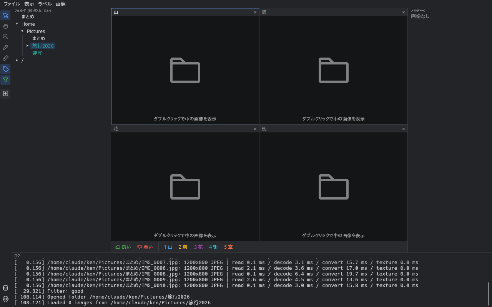

スロットの上の帯を **ヘッダ** と呼びます。

- ヘッダの左にファイル名、右に表示倍率と 2 つのボタン（⛶ = スロットに合わせる、1:1 = 実寸）と × が並びます
- 選んでいるスロットは枠が明るくなります
- フォルダのスロットにはフォルダの印が、ZIP のスロットには ZIP の印が出ます
- 1 つのスロットに複数の画像が入っているとき（フォルダをまとめて読んだとき・アニメーション）は、画像の右上に「何枚目 / 全部で何枚」が出ます
- フラグを付けた画像は、ヘッダの下端が緑（良い）か赤（悪い）になり、ヘッダにフラグとタグが出ます
- カメラ RAW を裏で現像している間は、ヘッダにフィルムの印が出ます

### フォルダのスロット

フォルダのスロットをダブルクリックすると、そのフォルダの画像を **1 つのスロットにまとめて** 読み込みます。
マウスホイールで中の画像を 1 枚ずつ送れるので、フォルダごとに見比べたいときに便利です。

- サブフォルダがあるときは、その中の画像も読むか尋ねます
- 画像がとても多いときは、**区切りの枚数**（初期値 500 枚）ごとに続けるか尋ねることもできます（設定の **大量の読み込みを確認**）
- ツリーでフォルダをクリックしたときの入れ方（画像ごとに 1 スロット / フォルダごとに 1 スロット）は、設定の **フォルダの読み込み先** で選べます。**Alt** を押しながらクリックすると、逆の入れ方で読み込みます

### 画像を動かす・拡大する

画像の上の左ドラッグの働きは、ツール列で選びます。**手のひら**（初期設定）は画像を動かし、**矢印** は画像をフォルダや地図へ運びます。**H** で手のひらと矢印を切り替えられ、選んだほうは次に起動したときも使います。右ドラッグの拡大・縮小はどちらでも同じです。

| 操作 | 動作 |
| --- | --- |
| 左ドラッグ | 画像を動かす（ツール列で手のひらを選んでいるとき。矢印のときは画像をフォルダへ運ぶドラッグになる） |
| 右ドラッグ（上下） | 押した位置を中心に拡大・縮小 |
| Ctrl+ホイール / タッチパッドのピンチ | マウスの位置を中心に拡大・縮小 |
| **+** / **-** | 拡大 / 縮小 |
| **0** / ヘッダの ⛶ | スロットに合わせる |
| **Ctrl+0** / ヘッダの 1:1 | 実寸（100%） |
| 画像を右クリック | **スロットに合わせる**・**コピー**・**RAW をセンサーのデータから現像**（カメラ RAW のとき） |
| **Ctrl+C** | 選んでいるスロットの画像をクリップボードへコピーする（ほかのアプリに貼り付けられる） |

- 画像は初め、スロットいっぱいに合わせて表示します（小さな画像も拡大して合わせます）
- まとめて読んだスロットで前後の画像に送っても、倍率と位置はそのまま保ちます。同じ場所を何枚も見比べるときに便利です（設定の **前後の画像で倍率と位置を保つ** で切れます）

### 画像を送る

| 操作 | 動作 |
| --- | --- |
| **→** / **Space**、**←** | 次 / 前の **画像のスロット** を選ぶ。フォルダのスロットは飛ばし、端まで行ったら反対側へ回る。スロットの中身は変わらない |
| **Ctrl+→** / **Ctrl+←** | 次 / 前のスロットを選ぶ（フォルダのスロットも含む） |
| マウスホイール | まとめて読んだスロットの上では、その中の次 / 前の画像。1 枚ずつのスロットが並んでいるときは次 / 前のスロットへ。1 枚だけ表示しているとき（1x1 か最大化）は次 / 前の画像 |

### 最大化とスライドショー

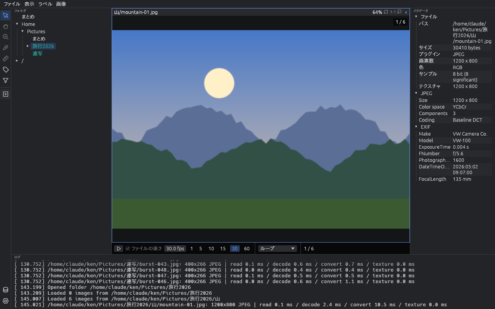

| 操作 | 動作 |
| --- | --- |
| スロットをダブルクリック / **Enter** | そのスロットを画像ウインドウいっぱいに最大化する。もう一度で元に戻る |
| **P** | スライドショーの再生 / 一時停止。スロットを最大化して、下の再生バーで速さを選ぶ |

最大化すると、画像ウインドウの下に **再生バー** が出ます。

- **▶**: 再生 / 一時停止
- **ファイルの速さ**: アニメーション（GIF / WebP）など、速さが書かれているファイルを、その速さで再生します。FPS を変えると外れます
- **FPS の欄と 1・5・10・15・30・60**: 1 秒あたりのコマ数。欄はドラッグか入力で変えられ、変えた値は次も使います
- **ループ / 最後で止める / 往復**: 最後の画像まで行ったときの動き
- **コマ落ち**: 表示が追いつかずに飛ばしたコマの数（直近 5 秒の分）

### レイアウトとページ

画像ウインドウにスロットをどう並べるかを **レイアウト** と呼びます。**表示 → レイアウト** か **Alt+数字** で選びます。

| キー | レイアウト | 並べ方 |
| --- | --- | --- |
| **Alt+0** | 自動（初期値） | スロットの数に合わせて、正方形に近いマス目を毎回決める |
| **Alt+1** | 1 x 1 | 1 枚ずつ大きく |
| **Alt+2** / **Alt+3** | 1 x 2 / 2 x 1 | 2 枚を上下 / 左右に |
| **Alt+4** / **Alt+5** / **Alt+6** | 2 x 2 / 3 x 3 / 4 x 4 | 4 枚 / 9 枚 / 16 枚 |
| **Alt+7** | カスタム | 設定の **カスタムレイアウト** の 列 x 行（初期値 6 x 6、各 1〜8） |

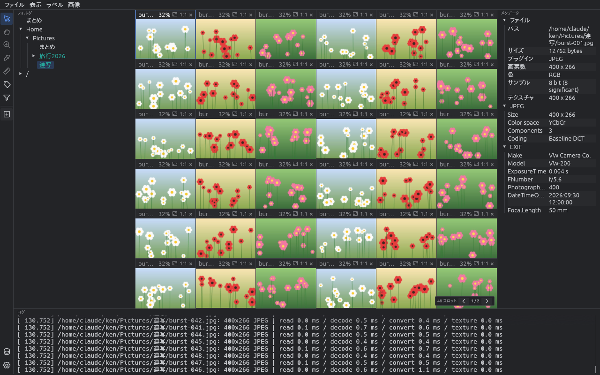

- **自動** では、**自動レイアウトの最大**（初期値 6 x 6 = 36 個）まではすべてのスロットを 1 ページに並べます。それより多いときは、スロットが小さくなりすぎないよう、最大のマス目でページに分けます
- 2 x 2 などに固定したときは、入りきらないスロットを次のページに回します。スロットが足りないマスにも空のスロットを描きます。空のスロットをクリックするとそこが選ばれ、次にツリーから開いた画像がそこに入ります
- ページに分かれると、画像ウインドウの右下に **「48 スロット ＜ 1 / 2 ＞」** のような帯が出ます。左から、スロットの総数、今のページ / ページ数、前後のページへのボタンです
- **PageDown** / **PageUp** でも次 / 前のページへ移れます

### スロットを足す・閉じる

| 操作 | 動作 |
| --- | --- |
| **Ctrl+N** / **ファイル → スロットを追加** / 左の列の ⊞ | 空のスロットを足す |
| **Ctrl+W** / スロット右上の × | スロットを閉じる |
| **Ctrl+Shift+W** / **ファイル → すべてのスロットを閉じる** | すべてのスロットを閉じる |

### ファイルを移動・コピーする

| 操作 | 動作 |
| --- | --- |
| スロットのヘッダを、ツリーのフォルダかフォルダのスロットへドラッグ | 画像をそのフォルダへ **移動**（確認あり）。フラグとタグも一緒に移る。ツール列で矢印を選んでいるときは、画像そのものをドラッグしても同じ |
| 同じく **Ctrl** を押しながらドラッグ | **コピー**（確認なし）。フラグとタグも一緒にコピーする |

- 移す先に同じ名前のファイルがあるときは、上書きせずに何もしません（ログに出ます）
- ZIP の中へは移せません（読むだけのため）

### ZIP・7z・tar を開く

ZIP / 7z / tar は、フォルダと同じように中の画像を見られます。開けるのは次のものです。

| 種類 | 拡張子 |
| --- | --- |
| ZIP・7z | `.zip` `.7z`（パスワード付きも可） |
| tar | `.tar`、圧縮したもの `.tar.gz` `.tgz` `.tar.bz2` `.tbz2` `.tar.xz` `.txz` `.tar.zst` `.tzst` |
| 漫画のページを束ねたもの | `.cbz`（中身は ZIP）`.cb7`（7z）`.cbt`（tar） |
| 1 ファイルだけを圧縮したもの | `.gz` `.bz2` `.xz` `.zst`。中のファイル 1 つが入ったフォルダとして開きます。`.fits.gz` は画像としてそのまま開きます |

1. ツリーかスロットで ZIP をクリック（スロットならダブルクリック）します
2. 一時フォルダ（設定の **ZIP・7z の展開先** で変えられます）に展開して、ツリーの先頭に別のルートとして出し、その中へ移ります
3. パスワード付きのものは、パスワードを尋ねます（パスワードは覚えません）
4. 見終わったら、ツリーの ZIP のルートを右クリック → **ZIP を閉じる** で閉じます。展開したファイルを消します（vw を終了したときも消えます）

- 中の画像は読むだけです。フラグやタグは付けられません
- ZIP の中のフォルダで **フォルダを開く** を選ぶと、ZIP の置いてあるフォルダを開きます
- 日本語の Windows で作った古い ZIP や tar の、Shift_JIS の名前も化けずに出ます
- RAR・LZH・CAB・ISO や、分割したもの（`.7z.001` など）は開けません。フォルダにあると、ログに黄色で「非対応アーカイブファイル：フルパス」と出ます
- tar の中のリンク（シンボリックリンク・ハードリンク）は展開しません

### カメラ RAW

- 開くとまず、カメラが RAW ファイルに埋め込んだプレビュー画像をすぐに表示します
- 続けて裏でセンサーのデータを現像し、終わったら精細な画像に差し替えます。現像中はヘッダにフィルムの印が出ます
- 裏の現像を止めたいときは、設定の **RAW を裏で現像** を切ります。そのときは **D** キーか、画像の右クリック → **RAW をセンサーのデータから現像** で 1 枚ずつ現像できます
- 現像した画像の明るさは、プレビューに合わせます

### 自動で行うこと

- **フォルダの監視**: 今いるフォルダに画像が増えたらスロットを足し、消えたらスロットを閉じます。
  最後の画像を表示しているスロットは新しい画像に移ります（1 枚だけ表示しているときは常に新しい画像へ）。
  撮影しながら PC に取り込むときに、最新の 1 枚を追いかけられます。
  表示中の画像が上書きされたら、倍率と位置を保ったまま読み直します。設定の **自動リロード** で止められます
- **前回の状態を戻す**: ウインドウの位置と大きさ、ツリーの開いていたフォルダ、いたフォルダを次の起動時に戻します。
  モニタの構成が変わったときは OS の標準の位置に出ます（Wayland では大きさだけ）

### メタデータウインドウ

- **ファイル**: パス、サイズ、読み込んだプラグイン、画素数、色、サンプル（ビット数）、表示に使っている画像の大きさ
- **形式ごとのグループ**（JPEG、PNG など）: その形式の情報
- **EXIF**: カメラ、レンズ、ISO、シャッター速度、絞り、撮影日時など
- グループの見出しをクリックすると開閉します（設定の **グループ見出しのクリック** で、選ぶだけにもできます）
- 行を選んで **Ctrl+C**、または右クリック → **コピー** で値をコピーできます
- **撮影地点**: EXIF に GPS がある写真の緯度・経度・高度（10 進の度）。地名のデータがあれば、近くの町の **地名**（国・都道府県・市区町村）も出します

### 地図で撮影地点を見る

設定の **地図 → 地図を使う** をオンにすると、**表示 → 地図**（**Ctrl+M**）で地図のウインドウが開きます。EXIF に GPS がある写真の撮影地点を、地図の上に赤い点で出します。

- 右上で、**このフォルダ**（今開いているフォルダの写真）と **データセット全体**（登録したデータセットの検索カタログにある写真）を切り替えます。データセットの写真は、検索カタログを **更新** すると位置が入ります
- ドラッグで移動、ホイールで拡大・縮小、ダブルクリックで 1 段拡大します。東西はどこまでもスクロールでき、日付変更線をまたいでもつながります
- 近い点は数字入りの丸にまとまります。丸をクリックするとその範囲に拡大し、同じ所で撮った写真は一覧で出します
- 点をクリックすると、縮小画像・ファイル名・撮影日時が出ます。**開く** で、その写真のフォルダへ移って写真を選びます
- 左上の **地名で探す** に町・都道府県・国の名前（日本語か英語）を入れると候補が出て、選ぶとそこへ移ります。初めは **地名...** を押し、出てくるダウンロードの画面で **地名（GeoNames）** をダウンロードします（約 4 MB、設定フォルダの `models/geonames` に入ります）
- 地名のデータがあると、点の情報とメタデータウインドウに近くの町の名前が出ます。データセットの検索カタログを **更新** すると、メタデータの `location` に国（`Country`）・都道府県（`Region`）・市区町村（`Town`）が日本語と英語で入り、詳細検索の条件にできます
- 地図の絵は、初期設定では [OpenStreetMap](https://www.openstreetmap.org/copyright) の標準のタイルを使います。地図を開いている間だけ、見えている所の絵を取り、設定フォルダの `map-tiles` に 7 日以上残します。つながらないときは方眼の上に点だけを出します
- 地図の絵の取得元は **地図の絵の URL** で変えられます。使う提供元の利用条件に従い、出典（**地図の出典**）を合わせて変えてください
- 画像のスロットの見出しを地図の上へドラッグして放すと、そこを撮影地点にします（EXIF に位置がない写真でも、ある写真でも）。置いた位置は EXIF の位置より優先し、メタデータウインドウの「撮影地点」に **位置の出どころ: 地図** と出ます。EXIF は書き換えず、フォルダの `.vw-labels.json` に残します。データセットの検索カタログには、**更新** したときに入ります
- 置いた位置は、点の右クリックか点の情報の **位置を消す** で消せます（EXIF に位置があれば、そこへ戻ります）。**Ctrl+Z**（**ラベル → 位置の変更を元に戻す**）で、置いた・消したのを 1 つずつ戻せます
- ZIP / 7z の中の画像には置けません

### 星図で写した範囲を見る

**表示 → 星図** で星図のウインドウが開きます。天体の画像（FITS）が空のどこを写したかを、星（6 等級まで）と星座の線・境界・名前の上に枠で出します。ネットは使いません。

- 枠の描き方は、ヘッダで分かることによって 3 通りです
  - **黄色の実線**: ヘッダに WCS（`CTYPE` `CRVAL` `CRPIX` `CD` など）がある画像。写った範囲がはっきり分かります。投影は TAN・SIN・ARC・STG・ZEA を読みます
  - **赤の点線**: 架台の向き（`RA` `DEC`、または `OBJCTRA` `OBJCTDEC`）と、焦点距離（`FOCALLEN`）・画素の大きさ（`XPIXSZ` `YPIXSZ`）がある画像。画角から見積もった範囲を、北を上にして描きます（回転は分かりません）
  - **赤の十字**: 架台の向きだけがある画像
- 右上で、**このフォルダ** と **データセット全体**（検索カタログにある FITS）を切り替えます
- ドラッグで移動、ホイールで拡大・縮小、ダブルクリックで 2 倍にします。左下にカーソルの所の赤経・赤緯が出ます
- 枠をクリックすると、縮小画像・ファイル名・`OBJECT`・`DATE-OBS`・中心の赤経・赤緯が出ます。**開く** で、その画像のフォルダへ移って画像を選び、その画像を先に読み込みます。同じ対象を続けて撮った画像のように枠が重なった所では、一覧から選びます
- アクティブなスロットの画像の枠は太く描きます
- 枠の色は設定の **星図** で変えられます。使わないときは **星図を使う** を切るとメニューから消えます

---

## 2. タグを付ける

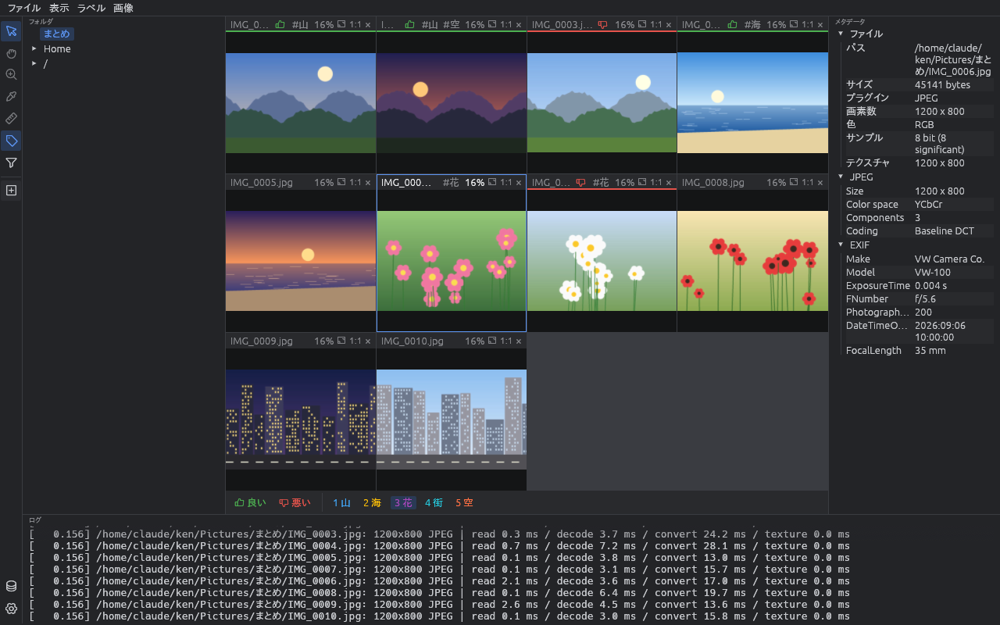

### フラグとタグ

vw では、画像に 2 種類の印（まとめて **ラベル** と呼びます）を付けられます。

| 種類 | 内容 | キー |
| --- | --- | --- |
| **フラグ** | 「良い」か「悪い」のどちらか 1 つ。写真の選別（残す / 捨てる）に使う | **↑**（良い） / **↓**（悪い） |
| **タグ** | 自分で決めた名前（例: 山・海・花）。1 枚にいくつでも付けられる | **1**〜**9** |

ラベルは画像ファイルには書き込みません。フォルダごとの `.vw-labels.json` という小さなファイルに保存します
（[ファイルの中身](#vw-labelsjsonラベル)）。フォルダを移動・コピーしても、ラベルはそのフォルダと一緒に動きます。

### 準備: タグを決める

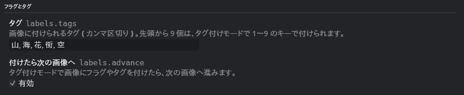

設定の **フラグとタグ** → **タグ** に、使うタグをカンマ区切りで入れます。

```
山, 海, 花, 街, 空
```

- 先頭から 9 個が、数字キー **1**〜**9** に対応します（10 個目からは、タグ付けバーのクリックで付けます）
- 同じ名前のタグは 2 つ作れません
- タグの名前を変えても、もう付けたラベルの名前は変わりません

### タグ付けモード

**T** キーか、左の列のタグのボタンで **タグ付けモード** に入ります。もう一度押すと抜けます。

タグ付けモードの間は、画像ウインドウの下に **タグ付けバー** が出て、選んでいる画像のフラグとタグが色付きで光ります。
バーのボタンをクリックしても付け外しできます。

| キー | 動作 |
| --- | --- |
| **↑** | 「良い」のフラグを付ける。もう一度押すと外す |
| **↓** | 「悪い」のフラグを付ける。もう一度押すと外す |
| **1** 〜 **9** | 1〜9 番目のタグを付ける。もう一度押すと外す |
| **→** / **←** | 次 / 前の画像のスロットへ |

- フラグかタグを付けると、自動で次の画像へ進みます。キーを押し続けるだけで、どんどん選別できます（設定の **付けたら次の画像へ** で止められます）
- ↑ ↓ と数字キーは、タグ付けモードの間だけ働きます。ふだんは誤って付けることはありません
- ZIP の中の画像には付けられません

**おすすめの選別の流れ**

1. 選別したいフォルダを開き、**Alt+1**（1 x 1）で 1 枚ずつ大きく表示します
2. **T** でタグ付けモードに入ります
3. 1 枚ずつ見て、残すものは **↑**、捨てるものは **↓** を押します。押すと次の画像へ進みます
4. 必要なら数字キーでタグも付けます

### 絞り込み

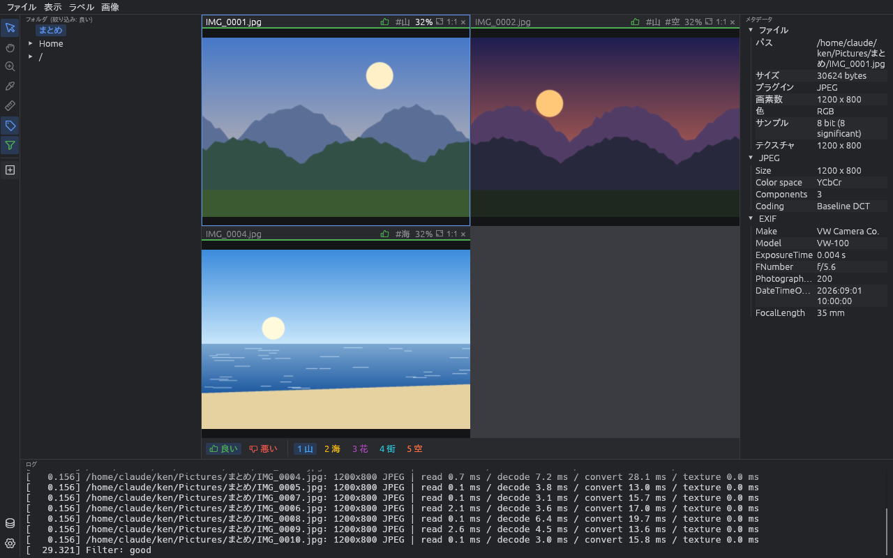

付けたラベルで、表示する画像を絞り込めます。

| 方法 | 動作 |
| --- | --- |
| 左の列の漏斗のボタン | 押すたびに すべて → 良い → 悪い → フラグなし → 各タグ → すべて と切り替わる。色で今の絞り込みが分かる |
| **ラベル** メニュー | **すべての画像を表示** / **良い画像だけを表示** / **悪い画像だけを表示** / **フラグのない画像だけを表示** / **タグで絞り込み** |
| **Ctrl+Shift+0** / **Ctrl+Shift+↑** / **Ctrl+Shift+↓** / **Ctrl+Shift+U** | すべて / 良い / 悪い / フラグなし |

- 絞り込みは、画像ウインドウのスロット、画像送り、フォルダの読み込み、スライドショーに効きます
- 絞り込み中は、フォルダウインドウの見出しに今の絞り込み（例: 「絞り込み: 良い」）が出ます

### 書き出し

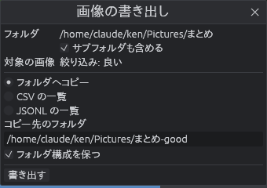

**ラベル → 画像を書き出す...**（**Ctrl+E**）で、今いるフォルダの、絞り込んだ画像を書き出します。

| 項目 | 内容 |
| --- | --- |
| フォルダ | 対象のフォルダ（今いるフォルダ）。**サブフォルダも含める** で下のフォルダも対象にできる |
| 対象の画像 | 今の絞り込み（例: 「絞り込み: 良い」） |
| 書き出し方 | **フォルダへコピー** / **CSV の一覧** / **JSONL の一覧** |
| コピー先のフォルダ | コピーするときの出力先。**フォルダ構成を保つ** を外すと、1 つのフォルダに平らに並べる（同じ名前は番号を付けて分ける） |
| 書き出すファイル | 一覧を書き出すときのファイル |

**CSV の一覧** は `パス, フラグ, タグ` の 3 列です。タグは `;` で区切ります。

```csv
/home/me/Pictures/まとめ/IMG_0001.jpg,good,山
/home/me/Pictures/まとめ/IMG_0002.jpg,good,山;空
/home/me/Pictures/まとめ/IMG_0003.jpg,bad,
```

**JSONL の一覧** は 1 行に 1 枚の JSON です。フラグがないときは `null` です。

```json
{"path":"/home/me/Pictures/まとめ/IMG_0001.jpg","flag":"good","tags":["山"]}
{"path":"/home/me/Pictures/まとめ/IMG_0006.jpg","flag":null,"tags":["花"]}
```

- 元の画像は動かしません（コピーするだけです）。コピー先に同じ名前のファイルがあれば上書きしません
- サブフォルダを含めてコピーするとき、途中にある ZIP / 7z の中の画像も、`data.zip` のように ZIP と同じ名前のフォルダの下へ書き出します。
  パスワード付きのものは、ツリーで開いてからその中で書き出してください。絞り込み中は、ZIP の中の画像にはラベルがないので対象外です
- ZIP の中で書き出すときの、出力先の初期値は ZIP の隣です

**機械学習の学習データを作るとき** は、タグで絞り込んでから **フォルダへコピー** を繰り返すと、
`山/`・`海/`・`花/` のようにタグごとのフォルダに分けられます。CSV / JSONL の一覧は、学習用のスクリプトでそのまま読み込めます。

### 悪い画像をまとめて消す

**ラベル → 悪い画像をごみ箱へ...** で、今いるフォルダの「悪い」のフラグの画像を、まとめて OS のごみ箱へ送ります。

- 送る前に、枚数とファイル名を確認します
- サブフォルダの画像は対象にしません
- ごみ箱へ送るだけなので、間違えたときはごみ箱から元に戻せます

### AI タグと顔

AI のモデルで、画像に内容のタグを付けたり、写っている人を見分けたりできます。モデルは CPU で動き、
画像を外へ送ることはありません。

1. **AI タグ → AI のモデル...** で、3 つのモデルをすべて **ダウンロード** します（設定フォルダの `models` に入ります）。
   すべて揃うまで、AI タグ付けと顔探しは押せません
   - ONNX Runtime（約 60 MB、MIT）: どちらの機能にも要ります
   - WD tagger v3（約 380 MB、Apache-2.0）: AI タグ用
   - YuNet + SFace（約 39 MB、YuNet は MIT、SFace は Apache-2.0）: 顔用
   - どれも配布元の決まった版を取り、vw が持っている SHA-256 などのハッシュと合うかを確かめます。合わないファイルは使いません
2. **AI タグ**: 画像を右クリック → **AI タグを付ける**。フォルダごとなら **AI タグ → このフォルダに AI タグを付ける**
   か、フォルダツリーの右クリック。タグは確信度つきでメタデータウインドウの「AI タグ」に出ます。
   手で付けるタグとは別に `.vw-ai-tags.json` に保存します。ログには始めと終わりの 1 行ずつが出て、
   進み具合はメインウインドウの下の線と、ターミナル風のログウインドウの下の行に出ます
3. **顔**: 画像を右クリック → **顔を探す**。見つけた顔に枠が出ます。枠を右クリック →
   **新しい人物として登録...** で名前を付けると、次から同じ人の顔に名前が付きます（緑の枠。分からない顔は黄色の枠。
   色は設定の **AI タグ** で変えられます）
4. 登録した人物は **AI タグ → 人物...** で一覧できます。名前で絞り込み、最初の登録日や写っている画像の枚数で並べ替え、
   大・中・小の大きさの切り替えができます。人物を選ぶと、名前の変更・削除と、代表の顔の設定（顔を右クリック）ができます。
   登録・名前の変更・削除のたびに、前に見つけた顔も照合し直します。
   **未登録の顔** のタブには、名前の付いていない顔が似たものどうしにまとまって並びます。まとまりに名前を入れて
   **登録** を押すと、その顔を全部その人物として登録します。違う人が混ざっていたら顔を右クリック →
   **このまとまりから外す**、通りがかりの人などは **隠す** で一覧から外せます
5. **AI タグ → 相関図...** では、作品などごとに図を作り、人物を置いて線でつなげます。人物を右クリック →
   **ここから線を引く** で線を引き、線を選ぶと関係の名前（親子、同僚など）を付けられます。
   同じ画像に一緒に写った人どうしには点線が自動で出て、一緒に写った枚数が多いほど線が太くなります。
   選んだ人物とそのあいだの線は、Ctrl+C / Ctrl+V で別の図へコピーできます。
   人物の一覧は、上の欄で相関図を選ぶと、その図にいる人だけに絞り込めます
6. AI タグと顔の記録は、画像の右クリック → **AI タグを消す**、または **AI タグ → このフォルダの AI タグを消す...** で消せます（登録した人物は残ります）
7. 要らないタグだけを消すには、メタデータウインドウのタグを右クリックします（この画像から / フォルダの全画像から / 今後付けない）。
   **AI タグ → このフォルダの AI タグを整理...** では、開いているフォルダのタグを枚数つきで一覧し、いくつか選んでまとめて消せます。
   「今後付けない」にしたタグは **設定 → AI タグ → 付けないタグ** に入り、次から付きません
8. データセットに登録したフォルダでは、AI タグと人物の名前も検索カタログに入り、データセットの画面で探せます
   （[詳しい条件](#詳しい条件) のメタデータの種類 `ai tags`）。AI タグを付けたり名前を付けたりした後は、データセットを **更新** してください

- 顔の特徴（似ているかを比べる数値）は個人を見分けられる情報なので、画像のフォルダには書かず、
  この PC の設定フォルダ（`people.json` と `faces`）だけに置きます
- 実写の顔向けです。イラストの人物は AI タグのキャラクターで見分けます
- しきい値は **設定 → AI タグ** で変えられます

---

## 3. カタログで管理する

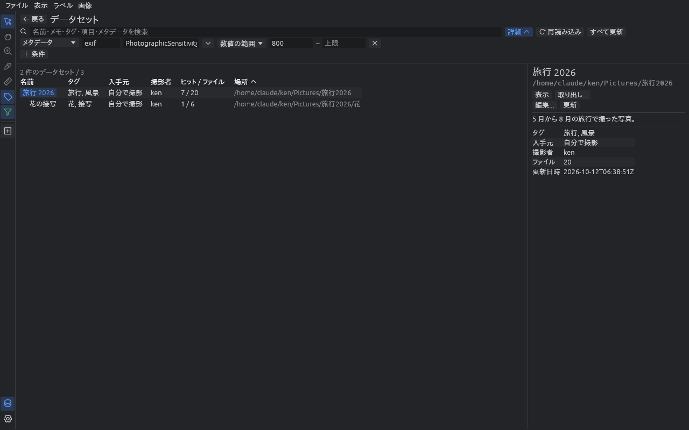

### データセットと検索カタログ

画像がたくさんあると、どのフォルダに何があるのか分からなくなります。
vw では、まとまりのあるフォルダを **データセット** として登録しておくと、あとから中身で探せるようになります。

- データセットを登録すると、vw はそのフォルダ以下の画像（ZIP / 7z の中も）をすべて読み、
  画像の形式・大きさ・撮影情報（EXIF）などを集めた **検索カタログ** を作ります
- 検索カタログは、データセットのフォルダの直下に `vw-search-catalog.json` という 1 つのファイルとして置きます。
  フォルダごと移動・コピーすれば、カタログも一緒に動きます。ネットワークドライブや外付けディスクに置いたデータセットも、そのまま探せます
- データセットには、**名前・メモ・タグ** と、自分で決めた **項目**（例: 入手元・撮影者）を書き込めます
- 画像ファイルには何も書き込みません

### 準備: 探す場所と項目を決める

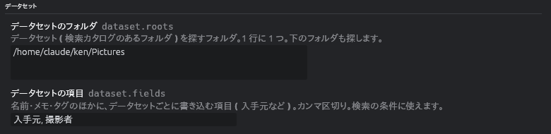

設定の **データセット** で、次の 2 つを決めます。

| 設定 | 内容 | 例 |
| --- | --- | --- |
| **データセットのフォルダ** | データセットを探すフォルダ。1 行に 1 つ。その下のフォルダもすべて探す | `C:\Users\me\Pictures`<br>`D:\Archive` |
| **データセットの項目** | 名前・メモ・タグのほかに、データセットごとに書き込む項目。カンマ区切り | `入手元, 撮影者` |

**データセットの項目** は、データセットの画面で一覧の列になり、検索の条件にも使えます。
あとから項目を足しても、もう書いたデータセットの値は消えません。

### データセットを登録する

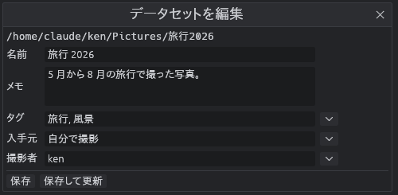

1. フォルダツリーで、データセットにしたいフォルダを右クリック → **データセットとして登録...** を選びます
2. ダイアログに、次を入れます
   - **名前**: 一覧に出る名前（初期値はフォルダ名）
   - **メモ**: 自由に書けるメモ（複数行）
   - **タグ**: カンマ区切り。▼ で、ほかのデータセットで使ったタグから選べます
   - **項目**（設定で決めたもの）: ▼ で、ほかのデータセットで使った値から選べます
3. **登録** を押すと、フォルダ以下のファイルを読んで検索カタログを作ります。ウインドウの下の赤い線が進み具合です

- パスワード付きの ZIP / 7z があると、パスワードを尋ねます（保存しません）。**スキップ** を押すとその ZIP を対象外にして、「読めなかったもの」として検索カタログに記録します
- 読めなかったファイル（壊れた画像など）も「読めなかったもの」として記録し、データセットの詳細に件数が出ます
- 書き込めないフォルダ（読み取り専用のメディアなど）は登録できません
- 登録したフォルダは、フォルダツリーで名前の色が変わります（青緑）

### 編集・更新する

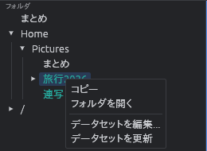

登録したフォルダを右クリックすると、メニューが変わります。

| メニュー | 動作 |
| --- | --- |
| **データセットを編集...** | 名前・メモ・タグ・項目を直す。**保存** はカタログの情報だけを書き換え、**保存して更新** はファイルも読み直す |
| **データセットを更新** | フォルダ以下の全ファイルを読み直して、検索カタログを作り直す。名前やメモはそのまま。増えた・消えた・変わったファイルの数をログに出す |

画像を足したり消したりしたら、**更新** してください。更新するまで、検索カタログは前の中身のままです。

### データセットを探す

**Ctrl+D** か **表示 → データセット** で、データセットウインドウが開きます。もう一度 **Ctrl+D** で閉じます。

- 画面を開くたびに、**データセットのフォルダ** 以下の検索カタログを探し直します。vw の外でカタログを消したり足したりしても、開き直せば反映されます
- **再読み込み** のボタンでも、いつでも探し直せます

#### かんたん検索

上の検索欄に語を入れると、**名前・メモ・タグ・項目・メタデータ** のどれかにその語を含むデータセットに絞り込みます。

- 空白で区切って複数の語を入れると、すべての語を満たすものに絞ります（例: `旅行 VW-100`）
- 大文字と小文字は区別しません

#### 詳しい条件

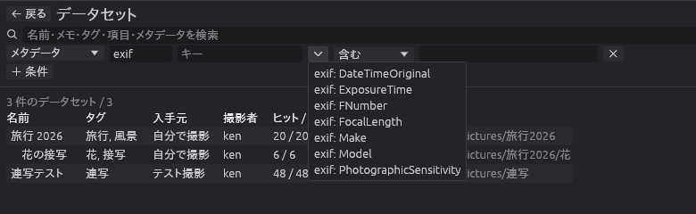

検索欄の下の **＋ 条件** で、条件を足せます（**詳細** のボタンで、条件の欄を閉じたり開いたりできます）。
条件は 1 行に 1 つで、すべての条件を満たすデータセットだけが残ります。

1 つの条件は、次の 3 つを選んで作ります。

**① 対象**

| 対象 | 意味 |
| --- | --- |
| 名前 / メモ / タグ | データセットに書き込んだ名前・メモ・タグ |
| 項目（入手元など） | 設定で決めた項目 |
| メタデータ | データセットの中のファイルの情報。**種類** と **キー** で、どの情報かを決める |

メタデータは「種類・キー・値」の組で持っています。

| 種類 | 中身の例 |
| --- | --- |
| `image` | `format`（JPEG など）、`width`、`height`、ビット深度 |
| `exif` | `Make`（メーカー）、`Model`（機種）、`PhotographicSensitivity`（ISO）、`ExposureTime`、`FNumber`、`FocalLength`、`DateTimeOriginal` など |
| `jpeg`、`png` など | 形式ごとの情報。メタデータウインドウのグループ名を小文字にしたもの |
| `ai tags` | AI タグ。`person`（名前の付いた人物）、`tag`（一般のタグ）、`character`、`rating`、`model`（タグを付けたモデル）。確信度は入れない |

キーの欄の ▼ を押すと、検索カタログに実際にあるキーの一覧から選べます。キーを決めると、値の欄の ▼ でも実際にある値の一覧から選べます。

**グループ** の ▼ → **AI tags** を選ぶと、`person`・`character`・`tag` の「一致」の条件がまとめて並び、値を選ぶだけで探せます。

**② 比べ方**

| 比べ方 | 意味 | 例 |
| --- | --- | --- |
| 含む | 値にその文字を含む | `Model` が `VW` を含む |
| 一致 | 値がその文字と同じ | `format` が `JPEG` と一致 |
| 正規表現 | 値が正規表現に合う | `Model` が `^VW-(100\|200)$` に合う |
| 数値の範囲 | 値の先頭の数を、下限と上限で比べる（片方だけでもよい） | `PhotographicSensitivity` が 800 以上。`"50 mm"` のような値も 50 として比べる |
| 存在する | そのキーがある | `GPSLatitude` がある（位置情報つきの写真がある） |

**③ 値**: 比べる文字や数。

**メタデータの条件は、同じ 1 つのファイルで満たすものを数えます。**
たとえば「`Model` が `VW-200`」と「ISO が 800 以上」の 2 つの条件を足すと、
**VW-200 で ISO 800 以上で撮った写真** が 1 枚以上あるデータセットが残ります
（VW-200 の写真と、別の機種の ISO 800 の写真があるだけのデータセットは残りません）。

#### 結果の一覧

| 列 | 内容 |
| --- | --- |
| 名前 / タグ / 項目 | データセットに書き込んだもの |
| ヒット / ファイル | メタデータの条件を満たしたファイルの数 / データセットのファイルの数 |
| 場所 | データセットのフォルダ |

- 列の見出しをクリックすると、その列で並べ替えます。もう一度で逆順です
- データセットの中に別のデータセットがあるとき（入れ子）は、場所で並べると外側の下に字下げして出ます
- 一番上に件数（例: 「2 件のデータセット / 3」）が出ます。読めなかった検索カタログがあれば、その数も出ます

#### 詳細と操作

行をクリックすると、右に詳細が出ます。メモ、タグ、項目、ファイル数、更新日時、取り出し元、読めなかったもの（あれば）が並びます。

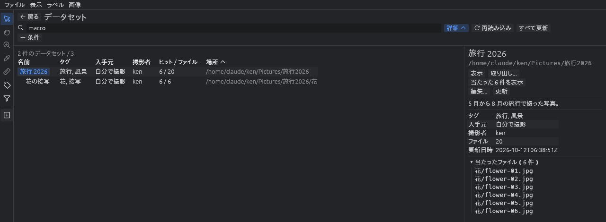

メタデータの条件（かんたん検索で、名前やメモではなく画像の情報に見つかった語も含みます）でファイルを絞り込んだときは、
詳細に **当たったファイル** の一覧も出ます。データセットのフォルダからの相対パスで並びます。

| ボタン | 動作 |
| --- | --- |
| **表示**（行のダブルクリックでも） | そのデータセットのフォルダへ移って画像を表示する。検索カタログにあるのに見つからないファイルがあれば、ログに出して更新を促す |
| **当たった n 件を表示** | 当たったファイルだけを、1 件 1 スロットで並べる（ファイルで絞り込んだときだけ出る）。ZIP / 7z の中のファイルは並べず、その数をログに出す（取り出せば見られる） |
| **取り出し...** | データセットのファイルを別のフォルダへ写す（下記） |
| **編集...** / **更新** | ツリーの右クリックと同じ |
| **すべて更新**（上の欄） | 一覧に出ているデータセットを、順にすべて更新する |

### データセットを取り出す

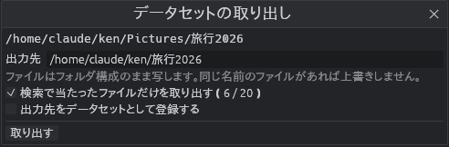

**取り出し...** で、データセットのファイルを別のフォルダへ写します。
共有フォルダから手元へ持ってくるときや、ほかの人に渡すときに使います。

- ファイルはフォルダ構成のまま写します。同じ名前のファイルがあれば上書きしません
- ZIP / 7z の中のファイルは展開して、`data.zip` のようにアーカイブと同じ名前のフォルダの下に置きます
- 出力先の初期値はユーザーフォルダの下で、2 回目からは前に取り出したフォルダの下になります
- 検索カタログは写しません。**出力先をデータセットとして登録する** に印を付けたときだけ、出力先に新しい検索カタログを作ります（名前などはダイアログで変えられます）。
  そのデータセットの詳細の **取り出し元** に、元のデータセットが出ます
- 別のデータセットの中に取り出したときは、その外側のデータセットを更新するか尋ねます
- 途中で止めたときは、写し終えたファイルは出力先に残ります
- ファイルで絞り込んだときは、**検索で当たったファイルだけを取り出す** に印が付いた状態で開きます。印を外すと、データセットのファイルをすべて写します

### 入れ子のデータセット

データセットの中に、別のデータセットを登録できます（例: `旅行2026` の中の `旅行2026/花`）。

- 外側のデータセットは、内側のファイルも含みます。外側で探しても、内側のファイルが見つかります
- 一覧では、場所で並べたときに外側の下に字下げして出ます

### カタログ管理のコツ

- **データセットはフォルダ単位** です。「撮影した日ごと」「入手元ごと」など、あとから見て意味のあるまとまりで登録すると探しやすくなります
- **項目を活用する**: 設定の **データセットの項目** に `入手元, 撮影者, ライセンス` などを足しておくと、一覧の列になり、条件にも使えます
- **中身を変えたら更新**: 画像を足したら **更新** か **すべて更新** を押してください
- **大きな値**: 2KB を超える値（埋め込まれたサムネイルなど）は、値の代わりに長さだけを記録します

---

## 設定

左下の歯車、**設定 → 設定**（または **Ctrl+,**）で設定に切り替わります。
**設定 → 設定フォルダを開く** / **AI モデルのフォルダを開く** で、設定ファイルやログ・人物の記録・AI モデルが入ったフォルダを開けます。

- 上の検索欄に語を入れると、項目を絞り込めます（日本語名・英語名・設定のキー名のどれでも）
- 変更はその場で反映され、自動で保存されます。保存ボタンはありません
- **設定ファイルを開く** で、設定ファイル（TOML 形式）を既定のエディタで開けます。エディタで保存すると、vw が自動で読み直します

### 項目の一覧

| グループ | 項目（キー） | 内容 | 初期値 |
| --- | --- | --- | --- |
| 外観 | テーマ（`appearance.theme`） | OS に従う / ダーク / ライト | OS に従う |
| | 言語（`appearance.language`） | English / 日本語 | English |
| | 表示倍率（`appearance.ui_scale`） | 文字とアイコンの大きさ | 1.00 |
| | パネルを詰めて表示（`appearance.compact`） | 余白を減らして、より多くの情報を表示する | 有効 |
| ビューワ | 背景色（`viewer.background`） | 画像の背後の色（`#RRGGBB`）。空欄ならテーマの既定色 | 空欄 |
| | フル解像度のメモリ上限（`viewer.full_image_limit_mb`） | フル解像度の画像に使うメモリの上限。超えた分は 512px の縮小画像で表示する | 256 MB |
| | スロットのレイアウト（`viewer.layout`） | 自動 / 1x1 / 1x2 / 2x1 / 2x2 / 3x3 / 4x4 / カスタム | 自動 |
| | カスタムレイアウト（`viewer.custom_layout`） | 表示メニューの「カスタム」で使う 列 x 行 | 6 x 6 |
| | 自動レイアウトの最大（`viewer.auto_layout_max`） | 自動レイアウトで使う最大の 列 x 行。超える数のスロットは次のページへ | 6 x 6 |
| | スライドショーの速さ（`viewer.slideshow_fps`） | 1 秒あたりのコマ数（0.1〜120） | 30 |
| | スライドショーの終わり（`viewer.slideshow_end`） | ループ / 最後で止める / 往復 | ループ |
| | コマ落ちを数える期間（`viewer.slideshow_drop_window_secs`） | 再生バーのコマ落ちを、直近の何秒の分で数えるか | 5 秒 |
| | 前後の画像で倍率と位置を保つ（`viewer.keep_view`） | まとめて読んだスロットで画像を送っても、倍率と位置を変えない | 有効 |
| | RAW を裏で現像（`viewer.develop_raw`） | カメラ RAW をプレビューで出してから、裏で現像して差し替える | 有効 |
| フォルダツリー | 並び順（`tree.sort`） | ファイル名（数字は数値として比較） / ファイル名（文字列として比較） / 更新日時 | 更新日時 |
| | 降順（`tree.sort_descending`） | 並び順を逆にする（Z から A、新しい順） | 有効 |
| | 大量の読み込みを確認（`tree.confirm_every`） | 区切りの枚数ごとに、続けるか尋ねる | 無効 |
| | 区切りの枚数（`tree.confirm_chunk`） | 次に確認するまでに読み込む枚数 | 500 枚 |
| | フォルダの読み込み先（`tree.load_into`） | 画像ごとに 1 スロット / フォルダごとに 1 スロット | 画像ごとに 1 スロット |
| | 逆の入れ方にするキー（`tree.other_load_modifier`） | このキーを押しながらフォルダを読み込むと、逆の入れ方で読み込む | Alt |
| 動作 | グループ見出しのクリック（`behavior.header_click`） | メタデータウインドウの見出しのクリックで、選択のみ / 選択して開閉 | 選択して開閉 |
| | 自動リロード（`behavior.auto_reload`） | 今いるフォルダを監視して、新しい画像や書き換えをすぐ反映する | 有効 |
| | ZIP・7z の展開先（`behavior.archive_dir`） | 開いた ZIP・7z を展開するフォルダ。中に `vw-archives` を作る。変えたあとに開くものから効き、開いているものは閉じるまで元の場所に置く | 空（OS の一時フォルダ） |
| フラグとタグ | タグ（`labels.tags`） | 画像に付けるタグ（カンマ区切り）。先頭 9 個が 1〜9 のキーに対応 | なし |
| | 付けたら次の画像へ（`labels.advance`） | タグ付けモードで付けたら次の画像へ進む | 有効 |
| データセット | データセットのフォルダ（`dataset.roots`） | データセットを探すフォルダ（1 行に 1 つ） | なし |
| | データセットの項目（`dataset.fields`） | 名前・メモ・タグのほかに書き込む項目（カンマ区切り） | なし |
| 地図 | 地図を使う（`map.enabled`） | 地図のウインドウを使う。開いている間、地図の絵を外のサーバーから取る | 無効 |
| | 地図の絵の URL（`map.tile_url`） | 地図の絵（タイル）の取得元。`{z}`・`{x}`・`{y}` をタイルの番号に置き換える | OpenStreetMap |
| | 地図の出典（`map.attribution`）・リンク（`map.attribution_url`） | 地図の右下に出す出典 | © OpenStreetMap contributors |
| キーボードショートカット | 操作ごと（`keys.*`） | [キー操作の一覧](#キー操作の一覧) を参照 | |

### キーの割り当てを変える

設定の **キーボードショートカット** で、すべての操作のキーを変えられます。

- **＋** を押してからキーを押すと追加します（Esc で取り消し）。1 つの操作に複数のキーを割り当てられます
- 割り当て済みのキーをクリックすると外します。↺ で初期値に戻します
- 別の操作で使っているキーは割り当てられません（先にそちらから外してください）
- OS がよく使うキー（Alt+F4 など）は割り当てられますが、オレンジ色の警告が出ます。OS が先に使うと vw には届きません
- Ctrl+C / Ctrl+X / Ctrl+V はクリップボード用のため割り当てられません

### 設定ファイル

| OS | 場所 |
| --- | --- |
| Windows | `%APPDATA%\vw\settings.toml` |
| Linux | `~/.config/vw/settings.toml`（`XDG_CONFIG_HOME` があればその下） |

たとえば次のように書けます。書かれていない項目は初期値で動きます。

```toml
[appearance]
language = "ja"

[viewer]
layout = "auto"
auto_layout_max = "6x6"

[tree]
sort = "name_natural"
sort_descending = false

[labels]
tags = ["山", "海", "花", "街", "空"]

[dataset]
roots = ["C:\\Users\\me\\Pictures", "D:\\Archive"]
fields = ["入手元", "撮影者"]
```

- 値が壊れている項目は、その項目だけを初期値にして、ログに赤字で理由を出します
- 壊れたファイルを設定からの変更で上書きするときは、元のファイルを `settings.toml.bak` として残します

---

## キー操作の一覧

すべて [設定](#キーの割り当てを変える) で変えられます。メニューの右側には、今のキーが出ます。

### 見る

| キー | 動作 |
| --- | --- |
| → / Space | 次の画像のスロット |
| ← | 前の画像のスロット |
| Ctrl+→ / Ctrl+← | 次 / 前のスロット（フォルダのスロットも含む） |
| PageDown / PageUp | 次 / 前のページ |
| Enter | スロットの最大化 / 元に戻す（フォルダのスロットでは、そのフォルダへ移る） |
| Backspace | 1 つ上のフォルダへ |
| 0 | スロットに合わせる |
| Ctrl+0 | 実寸（100%） |
| + / = | 拡大 |
| - | 縮小 |
| P | スライドショーの再生 / 一時停止 |
| D | カメラ RAW をセンサーのデータから現像 |
| H | 左ドラッグを手のひら / 矢印に切り替え |
| Ctrl+C | 画像をクリップボードへコピー |

### レイアウトとスロット

| キー | 動作 |
| --- | --- |
| Alt+0 〜 Alt+7 | レイアウト: 自動 / 1x1 / 1x2 / 2x1 / 2x2 / 3x3 / 4x4 / カスタム |
| Ctrl+N | スロットを追加 |
| Ctrl+W | スロットを閉じる |
| Ctrl+Shift+W | すべてのスロットを閉じる |

### タグ付け

| キー | 動作 |
| --- | --- |
| T | タグ付けモードの切り替え |
| ↑ / ↓ | 良い / 悪いのフラグ（タグ付けモードの間だけ） |
| 1 〜 9 | タグ 1〜9（タグ付けモードの間だけ） |
| Ctrl+Shift+0 | すべての画像を表示 |
| Ctrl+Shift+↑ | 良い画像だけを表示 |
| Ctrl+Shift+↓ | 悪い画像だけを表示 |
| Ctrl+Shift+U | フラグのない画像だけを表示 |
| Ctrl+E | 画像を書き出す |

### 画面

| キー | 動作 |
| --- | --- |
| Ctrl+1 / 2 / 3 / 4 | フォルダツリー / メタデータ / 画像 / ログの表示切替 |
| Ctrl+D | データセット画面を開く・閉じる |
| Ctrl+M | 地図の表示切替（設定で地図を使うときだけ） |
| Ctrl+Z | 地図で置いた・消した位置を元に戻す |
| Ctrl+, | 設定を開く・閉じる |
| Ctrl+Q | 終了 |

### マウス

| 操作 | 動作 |
| --- | --- |
| ホイール | 画像やスロットを送る（[画像を送る](#画像を送る)） |
| 左ドラッグ | 手のひらのとき画像を動かす / 矢印のとき画像をフォルダへ運ぶ |
| 右ドラッグ（上下） / Ctrl+ホイール / ピンチ | 拡大・縮小 |
| ダブルクリック | スロットの最大化 / フォルダのスロットなら中の画像を読む |
| ヘッダをドラッグ | ファイルの移動（Ctrl でコピー） |
| 右クリック | 画像・ツリー・ログのメニュー |

---

## vw が作るファイル

vw は元の画像ファイルを書き換えません。代わりに、次のファイルを作ります。

| ファイル | 場所 | 中身 |
| --- | --- | --- |
| `settings.toml` | 設定フォルダ（Windows: `%APPDATA%\vw`、Linux: `~/.config/vw`） | 設定 |
| `state.toml` | 設定フォルダ | 終了時の状態（ウインドウの位置と大きさ、ツリーの開閉、いたフォルダ、取り出し先など）。vw が自動で書き換える |
| `.vw-labels.json` | ラベルを付けた画像のあるフォルダ | そのフォルダの画像のフラグとタグ |
| `labels/` | 設定フォルダ | 書き込めないフォルダ（読み取り専用のメディアなど）の画像のラベル |
| `vw-search-catalog.json` | データセットのフォルダの直下 | 検索カタログ |
| `map-tiles/` | 設定フォルダ | 地図の絵（タイル）。消しても、次に地図を開いたとき取り直す |

### .vw-labels.json（ラベル）

```json
{
  "version": 1,
  "files": {
    "IMG_0001.jpg": { "flag": "good", "tags": ["山"] },
    "IMG_0003.jpg": { "flag": "bad" },
    "IMG_0006.jpg": { "tags": ["花"] },
    "IMG_0007.png": { "position": { "latitude": 43.0621, "longitude": 141.3544 } }
  }
}
```

- ドットで始まるので、エクスプローラや Linux のファイルマネージャーでは隠しファイルとして扱われます
- 画像を vw で移動・コピーすると、ラベルも移す先のフォルダのファイルへ移ります
- `position` は地図で置いた撮影地点です（画像の EXIF は書き換えません）

### .vw-ai-tags.json（AI タグと顔の枠）

```json
{
  "version": 1,
  "files": {
    "IMG_0001.jpg": {
      "model": "wd-vit-tagger-v3",
      "general": [{ "name": "outdoors", "score": 0.81 }],
      "rating": { "name": "general", "score": 0.97 },
      "faces": [{ "rect": [0.35, 0.12, 0.18, 0.22], "score": 0.94, "person": "Eileen", "similarity": 0.96 }]
    }
  }
}
```

- 顔の枠は画像の幅・高さに対する割合です。顔の特徴はここには入りません

### vw-search-catalog.json（検索カタログ）

JSON のファイルで、主に次のものが入っています。

| キー | 中身 |
| --- | --- |
| `name` / `memo` / `tags` / `fields` | データセットの名前・メモ・タグ・項目 |
| `created` / `updated` | 作った日時と、更新した日時 |
| `source` | 取り出して作ったデータセットなら、元のデータセット |
| `meta` | 「種類・キー・値」の組の一覧。同じ組は 1 回だけ持つ |
| `files` | ファイルごとのパス（データセットのフォルダからの相対パス。ZIP の中は `data.zip!/day1/Z001.jpg` のように `!` で区切る）・大きさ・更新日時と、`meta` の何番目の組を持つか |
| `skipped` | 読めなかったファイルと理由 |

手で書き換える必要はありません。名前・メモ・タグ・項目は vw のダイアログで直せます。

---

## よくある質問と困ったとき

| 質問・症状 | 答え・対処 |
| --- | --- |
| メニューが英語になっている | 設定の **Appearance → Language** を **日本語** にします（[日本語表示にする](#日本語表示にする)） |
| ファイル名や日本語が □ になる | Windows では通常起きません。Linux は `sudo apt install fonts-noto-cjk` を実行して再起動してください（日本語の字形のフォントだけを使います。中国語フォントだけが入っている環境では □ になります） |
| ↑ ↓ や数字キーを押してもラベルが付かない | タグ付けモードになっているか確認してください（**T** キー）。ZIP の中の画像には付けられません |
| 数字キーのタグが付かない | 設定の **タグ** にタグがあるか確認してください。数字はタグの並び順に対応します |
| データセットの画面に何も出ない | 設定の **データセットのフォルダ** に、データセットのある親フォルダを入れてください |
| 画像を足したのに検索に出てこない | データセットを **更新** してください。検索カタログは更新するまで前の中身のままです |
| 検索カタログを消したのに一覧に残っている | データセットの画面を開き直すか、**再読み込み** を押してください |
| スロットがたくさんあって小さい | 設定の **自動レイアウトの最大** を小さくするか、**Alt+4**（2x2）などに固定して、ページで送ってください |
| 画像を消すつもりでフラグを付けたが、消し方が分からない | **ラベル → 悪い画像をごみ箱へ...** で、「悪い」の画像をまとめてごみ箱へ送れます |
| Chrome でダウンロードが止められる | `chrome://downloads` を開き、vw の行の **保存** を押してください |
| Linux で `libxkbcommon-x11.so could not be loaded` と出て起動しない | `sudo apt install libxkbcommon-x11-0` |
| 起動直後に落ちる / 画面が真っ黒 | vw は OpenGL 2.0 以上で描画します。OpenGL が足りないときは、自動で wgpu（Windows では DirectX 12、GPU がなければ Windows に標準のソフトウェア描画）で起動し直します。ログの先頭の `Renderer:` の行に、使っている描画の方法が出ます。どちらでも起動できないときは理由を窓に出すので、グラフィックドライバを更新してください。Linux のリモートデスクトップや仮想マシンでは `LIBGL_ALWAYS_SOFTWARE=1 vw` で動くことがあります |
| Windows で起動しない（窓も何も出ない） | zip の中の `check` フォルダの `check-vw.bat` をダブルクリックすると、Windows の版、VC++ ランタイム、OpenGL、起動の結果を調べて `vw-check-report.txt` にまとめます。ユーザー名やフォルダの場所は伏せてあるので、そのまま [Issue](#不具合の報告と要望) に貼れます。使い方は `check` フォルダの README.md にあります |
| 大きな画像が粗く見える | 一辺 8192 ピクセルを超える画像は、GPU の制限のため縮小して表示しています（ログに出ます）。また、フル解像度のメモリ上限を超えた分は縮小画像で表示します（設定の **フル解像度のメモリ上限** で増やせます） |
| 16bit 画像が暗い | 有効ビット数が記録されていない 16bit 画像は、16bit 全体を階調として表示します。階調の調整機能は今後追加します |
| 何かおかしい | 下のログウインドウを見てください。エラーは赤字で出ます。ログの行は右クリックでコピーできます。直らないときは [Issue](#不具合の報告と要望) で知らせてください |

---

## 不具合の報告と要望

不具合の報告・改良の提案・機能追加の要望は、[Issue（チケット）を起票](https://github.com/xex-ken-xex/vw/issues/new/choose)してください。テンプレートに沿って、vw の版（「ヘルプ」→「vw について」）・OS・手順を書いてもらえると助かります。
直し方が分かる場合は、その Issue を元にプルリクエスト（PR）を出してください。流れと決まりは [CONTRIBUTING.md](CONTRIBUTING.md) にあります。

アプリの「ヘルプ」→「vw について」の **不具合の報告・要望...** からも Issue の画面を開けます。

---

## 開発とビルド

### 必要なもの

| もの | 用途 |
| --- | --- |
| Rust（stable、rustup で導入） | コンパイラとビルドツール（cargo） |
| Windows: Visual Studio 2022 Build Tools の「C++ によるデスクトップ開発」 | Rust がリンカとして使います |
| Linux: build-essential | C コンパイラとリンカ |
| Git | ソースの取得 |

### 環境を自動で揃える

リポジトリを取得してから、OS に合ったスクリプトを実行します。
必要なものを入れたうえで、リリースビルドとテストまで行います。何度実行しても問題ありません。

**Windows**

```bat
git clone https://github.com/xex-ken-xex/vw.git
cd vw
scripts\setup-windows.bat
```

`scripts\setup-windows.bat` はエクスプローラーからダブルクリックしても動きます。
winget で Visual Studio Build Tools、Git、rustup を入れるため、途中で管理者権限の確認が出ます。
Build Tools の導入には数 GB のダウンロードと 10〜30 分ほどかかります。
Git がまだない場合は、先に [Git for Windows](https://git-scm.com/download/win) を入れるか、
GitHub の **Code → Download ZIP** でソースを取得してください。

**Ubuntu**

```sh
git clone https://github.com/xex-ken-xex/vw.git
cd vw
./scripts/setup-ubuntu.sh
```

`sudo` のパスワードを聞かれます。apt で必要なパッケージを入れ、rustup で Rust を入れます。

どちらも、環境だけ揃えてビルドしない場合は `-NoBuild`（Windows）/ `--no-build`（Ubuntu）を付けます。

### ビルドと実行

```sh
cargo run --release -- [フォルダ または 画像ファイル ...]   # ビルドして起動
cargo build --release                                       # 実行ファイルだけ作る
```

実行ファイルは `target/release/vw`（Windows は `target\release\vw.exe`）にできます。
開発中は `--release` なしの `cargo run` でも動きます。依存ライブラリは最適化してビルドするので、
デバッグビルドでも画像の読み込みはそれほど遅くなりません。

### テストとチェック

プルリクエストを出す前に、CI と同じ次のチェックを通してください。

```sh
cargo fmt --all --check                      # 書式
cargo clippy --all-targets -- -D warnings    # 静的解析（警告もエラー扱い）
cargo test                                   # 自動テスト
cargo deny check advisories sources          # 依存の既知の脆弱性・取り下げられた版・取得元（cargo install cargo-deny）
```

CI は Cargo.lock のままビルドする（`--locked`）ので、依存を変えたら Cargo.lock もコミットしてください。
依存の検査は週 1 回も自動で走り、コードを変えていなくても新しく見つかった脆弱性に気づけます。
GitHub Actions はコミット SHA で固定してあり、新しい版は Dependabot の PR で取り込みます。

### 変更を送る

Issue を起票してから PR を出してください。チェックの通し方と、コード・テスト・コミットログの書き方は [CONTRIBUTING.md](CONTRIBUTING.md) にあります。

### リポジトリの構成

```
crates/
  vw-core/   共通メモリ形式 (VwImage)、プラグインの定義 (DecoderPlugin)、描画用変換
  vw-png/    PNG プラグイン
  vw-jpeg/   JPEG プラグイン
  vw-bmp/    BMP プラグイン
  vw-webp/   WebP プラグイン
  vw-gif/    GIF プラグイン
  vw-tiff/   TIFF プラグイン
  vw-fits/   FITS（天体の画像）プラグイン
  vw-raw/    カメラ RAW プラグイン（rawler、LGPL-2.1）
  vw-dicom/  DICOM の読み込みと文字コード
  vw-ui/     見た目（配色・メニュー・パネル・フォント）。apps/ のアプリで共有する
  vw-tree/   フォルダツリーの基底と、それでフォルダやファイルを選ぶ窓。apps/ のアプリで共有する
apps/
  vw/          ビューア本体（実行ファイル vw）
  dicoamplio/  DICOM の評価データを水増しするツール（実行ファイル dicoamplio。apps/dicoamplio/README.md）
docs/        設計資料と README の画像
scripts/     開発環境の構築スクリプト
packaging/   配布物に同梱するファイル
```

設計の詳細は [docs/architecture.md](docs/architecture.md)、
コーディングのルールは [CLAUDE.md](CLAUDE.md) を参照してください。

### 新しい形式を追加する

1. `crates/vw-<形式名>` を作り、`vw_core::DecoderPlugin` を実装します
   - `probe` でファイル先頭のマジックナンバーを判定し、`decode` で `VwImage` を返します
   - 階調は落とさずに返します（16bit なら `PixelData::U16`）
2. `apps/vw/src/main.rs` の `registry()` に 1 行追加して登録します

`crates/vw-png` が実装例です。

### リリース

CI（GitHub Actions）が Linux と Windows でチェック・テスト・ビルドを行い、次のときに Release へ載せます。

| きっかけ | Release |
| --- | --- |
| main ブランチへの push（プルリクエストのマージ） | 「最新ビルド (main)」を置き換える |
| `v` で始まるタグの push | そのタグ名の正式版を作る |
| Actions の画面から CI を手動実行（版番号を入力） | main の最新コミットにタグを付け、正式版を作る |

正式版を出すときは、`Cargo.toml` の `version` を上げてから、次のどちらかを行います。

- GitHub の **Actions** → **CI** → **Run workflow** で、Branch を `main` のまま版番号（例: `v0.3.0`）を入れて実行する
- 手元の main でタグを付けて push する

```sh
git tag v0.3.0
git push origin v0.3.0
```

## セキュリティ

脆弱性を見つけたら、公開の Issue ではなく、GitHub の非公開の報告（**Security** タブ → **Report a vulnerability**）で知らせてください。
受け付けてからの流れと、直す版は [SECURITY.md](SECURITY.md) にあります。

## ライセンス

Copyright (c) 2026 vw contributors

作者は xex（GitHub: [xex-ken-xex](https://github.com/xex-ken-xex)）です。ソースは https://github.com/xex-ken-xex/vw にあります。アプリの「ヘルプ」→「vw について」と、Windows の EXE のプロパティ（「詳細」タブ）にも同じ表示があります。

vw は [MIT License](LICENSE-MIT) と [Apache License 2.0](LICENSE-APACHE) のどちらかを選んで使えます（`MIT OR Apache-2.0`）。
無償で、改変・再配布・商用利用ができます。どちらのライセンスでも、vw は現状のまま提供され、いかなる保証もありません。作者は vw の利用によって生じた損害に責任を負いません。

地図で使う地名のデータは [GeoNames](https://www.geonames.org/) のもので、[CC BY 4.0](https://creativecommons.org/licenses/by/4.0/) で提供されています。vw 用に必要な列だけを抜き出し、Release の `geodata-1` などに置いています（作り方: [tools/geodata/make_geodata.py](tools/geodata/make_geodata.py)）。地図の絵は © [OpenStreetMap](https://www.openstreetmap.org/copyright) contributors です。

AI のモデル（ONNX Runtime・WD tagger v3・YuNet・SFace）は配布物に入っておらず、使う人が「AI のモデル」の画面で選んだときに、それぞれの公開元から取ってきます。ライセンスはその画面と、上の「[AI タグと顔](#ai-タグと顔)」の一覧に書いてあります。日本語の文字は OS に入っているフォント（Windows は Yu Gothic やメイリオ）を使い、配布物には入れていません。英数字と記号は egui に入っているフォント（Ubuntu・Hack・Noto Emoji など）で、そのライセンスは下の一覧に入っています。

vw が使っているほかのソフトウェアのライセンスは、配布物の `THIRD-PARTY-LICENSES.txt` にまとめてあります（「vw について」の「サードパーティのライセンス...」でも開けます）。この一覧は CI で [cargo-about](https://github.com/EmbarkStudios/cargo-about) が作り、[packaging/about.toml](packaging/about.toml) にない種類のライセンスの依存が入るとビルドが失敗します。
