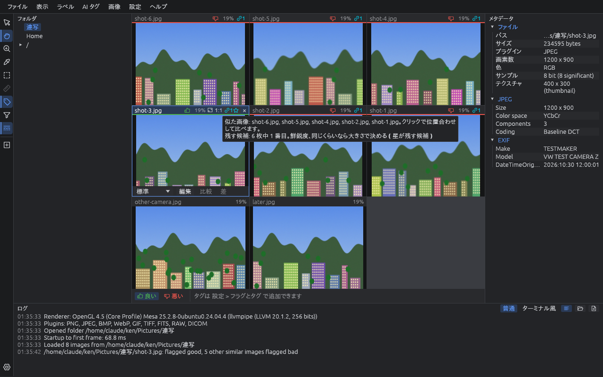

# 画像を見る

[README](../../README.md) › [使い方](README.md)

## 画面の見方


vw はメインウインドウの中を、4 つのウインドウに分けて使います。

| 場所 | 内容 |
| --- | --- |
| 上のメニュー | **ファイル**・**表示**・**ラベル**・**AI タグ**・**画像**・**設定**・**ヘルプ**。メニューの右側には、その操作のキーが出ます。1 つ開いたあとは、隣のメニューの名前にマウスを乗せるだけで切り替わります |
| 左端の列（ツール列） | 上から 選択（矢印）/ 手のひら / ズーム / 画素値の確認 / ROI / 計測（計測は準備中で灰色）、タグ付けモード、絞り込み、スロットの追加。下に設定のボタン |
| フォルダ（左） | フォルダと ZIP の木。クリックしたフォルダへ移り、中身を右の画像ウインドウに並べます。ホームと、Windows は各ドライブ、Linux は `/` から辿れます |
| 画像（中央） | 画像を表示する枠（スロット）を並べます |
| メタデータ（右） | 選んでいるスロットの画像の、ファイル情報と画像内の情報（EXIF など） |
| ログ（下） | フォルダを開いた・処理が終わったなどの記録で、エラーは赤字です。1 枚ごとの記録はログファイルにだけ書きます。見出しの右の **ターミナル風** にすると、黒地の端末のような表示になり、済んだ処理（ZIP の展開・コピー・データセット・送信・AI など）は緑の「Extracted」「Copied」のような行で積まれます。その下に、動いている処理を 1 件 1 行で名前・進み具合の棒・量と全体の数（「(2/5)」）で出し、最後に読み込みの集計（枚数・平均の時間・失敗の数・今読んだファイル）を常に書き換えて出します |

- 各ウインドウは **表示** メニューか Ctrl+1〜4 で表示・非表示を切り替えられます。画像だけを大きく見たいときは、ほかのウインドウを隠します
- ウインドウの境目はドラッグで動かせます。メインウインドウの位置と大きさ、ウインドウの並びと幅は次に起動したときも戻ります
- ウインドウの見出し（フォルダ・メタデータ・ログ）をドラッグすると、Visual Studio のような合体位置のガイドが出ます。ガイドに乗って離すと、ほかのウインドウの上下左右や、メインウインドウの端へ入れ直せます。ウインドウの下側に入れれば、その列を上下に分けて使えます
- 見出しをメインウインドウの外まで引き出すと、そのウインドウは別ウインドウになり、別のモニタにも置けます。別ウインドウはいつもメインウインドウより手前に出ます。Ctrl を押しながらドラッグするとガイドに吸い付かず、ドラッグ中に Esc を押すと元に戻ります
- ウインドウが 1 つだけの別ウインドウには見出しの行がなく、名前は OS のウインドウバーに出ます（ボタンのあるウインドウは、ボタンだけの行が出ます）。このときはウインドウバーをメインウインドウのガイドへドラッグすると戻せます（Linux の Wayland ではできません）
- 別ウインドウは、見出しをメインウインドウのガイドへドラッグするか、見出しの右クリックや **表示** → **ウインドウの配置** の **メインウインドウに戻す**、または見出しの Ctrl+ダブルクリックで戻せます。別ウインドウを閉じたウインドウは隠れ、表示メニューで出すと同じ位置に出ます
- 画像のウインドウは見出しがないので、**表示** → **ウインドウの配置** から別ウインドウに出したり戻したりします。**レイアウトを元に戻す** で最初の並びに戻ります
- 画素の変換・解析・ズームマップ・地図・星図・相関図・データセットもウインドウです。開くと別ウインドウで出て、ウインドウバーをドラッグすればメインウインドウに入れられます（Wayland では **表示** → **ウインドウの配置** から）。閉じたときの場所に、次に開いたときも出ます。データセットと画像の比較のほかは、開いたまま終えると、次に起動したときも同じ場所に開きます
- ZIP の展開や、データセットの読み込み・取り出し、書き出しの最中は、ウインドウの一番下に細い線が出ます。灰色の上を赤い線が右へ伸びて、進み具合を示します


## フォルダを開く

フォルダツリーは、エクスプローラと同じ感覚で使えます。

| 操作 | 動作 |
| --- | --- |
| ツリーでフォルダをクリック | そのフォルダへ移り、中のサブフォルダ・ZIP・画像を 1 つずつスロットに並べる |
| ツリーの ▶ をクリック | 開閉だけをする（フォルダは移らない）。中にフォルダのないフォルダには ▶ が出ない |
| **Backspace** / **ファイル → 1 つ上のフォルダへ** | 1 つ上のフォルダへ移る |
| フォルダのスロットをダブルクリック | そのフォルダの画像を、そのスロットにまとめて読む（下の [フォルダのスロット](#フォルダのスロット)） |
| フォルダのスロットで **Enter**、またはヘッダ右の矢印 | そのフォルダへ移る（矢印はマウスを乗せたときに出る） |
| エクスプローラなどからファイルやフォルダをドロップ | そのフォルダへ移る（ファイルなら、その画像を選ぶ） |
| ツリーのフォルダを右クリック → **フォルダを開く** | そのフォルダを、エクスプローラ（Linux では既定のファイルマネージャー）で開く |
| ツリーのフォルダを右クリック → **コピー** | フォルダのフルパスをクリップボードにコピーする |

- 並び順は、初めは **更新日時の新しい順** です。設定の **並び順** でファイル名順にもできます（ファイル名順では `img2` が `img10` より前に来ます）。初めは設定の **降順** が入っているので、ファイル名順にしたときは A から Z の順にするには降順を外してください
- ドットで始まる隠しフォルダと、Windows のごみ箱（`$RECYCLE.BIN`）は出しません
- 前回いたフォルダと、ツリーで開いていたフォルダは、次に起動したときに戻ります

## スロットの見方


スロットの上の帯を **ヘッダ** と呼びます。

- ヘッダの左にファイル名、右に表示倍率と 2 つのボタン（⛶ = スロットに合わせる、1:1 = 実寸）と × が並びます
- 選んでいるスロットは枠が明るくなります
- フォルダのスロットにはフォルダの印が、ZIP のスロットには ZIP の印が出ます
- 1 つのスロットに複数の画像が入っているとき（フォルダをまとめて読んだとき・アニメーション）は、画像の右上に「何枚目 / 全部で何枚」が出ます
- フラグを付けた画像は、ヘッダの下端が緑（良い）か赤（悪い）になり、ヘッダにフラグとタグが出ます
- カメラ RAW を裏で現像している間は、ヘッダにフィルムの印が出ます

## フォルダのスロット

フォルダのスロットをダブルクリックすると、そのフォルダの画像を **1 つのスロットにまとめて** 読み込みます。
マウスホイールで中の画像を 1 枚ずつ送れるので、フォルダごとに見比べたいときに便利です。

- サブフォルダがあるときは、その中の画像も読むか尋ねます
- 画像がとても多いときは、**区切りの枚数**（初期値 500 枚）ごとに続けるか尋ねることもできます（設定の **大量の読み込みを確認**）
- ツリーでフォルダをクリックしたときの入れ方（画像ごとに 1 スロット / フォルダごとに 1 スロット）は、設定の **フォルダの読み込み先** で選べます。**Alt** を押しながらクリックすると、逆の入れ方で読み込みます

## 画像を動かす・拡大する

画像の上の左ドラッグの働きは、ツール列で選びます。**手のひら**（初期設定）は画像を動かし、**矢印** は画像をフォルダや地図へ運び、**ズーム** は拡大・縮小します。**H** で手のひら、**Z** でズームに切り替えられ（もう一度押すと矢印）、選んだツールは次に起動したときも使います。起動するときのツールを決めておくには、設定の「起動したときのツール」（`viewer.start_tool`）で選びます。右ドラッグの拡大・縮小はどのツールでも同じです。

| 操作 | 動作 |
| --- | --- |
| 左ドラッグ | 画像を動かす（ツール列で手のひらを選んでいるとき。矢印のときは画像をフォルダへ運ぶドラッグになる） |
| 右ドラッグ（上下） | 押した位置を中心に拡大・縮小 |
| クリック / Alt+クリック | ズームのツールのとき、クリックした所を中心に 1 段拡大 / 縮小（左ドラッグの上下でも拡大・縮小） |
| Ctrl+ホイール / タッチパッドのピンチ | マウスの位置を中心に拡大・縮小 |
| **+** / **-** | 拡大 / 縮小 |
| **0** / ヘッダの ⛶ | スロットに合わせる |
| **Ctrl+0** / ヘッダの 1:1 | 実寸（100%） |
| 画像を右クリック | **スロットに合わせる**・**コピー**・**RAW をセンサーのデータから現像**（カメラ RAW のとき） |
| **Ctrl+C** | 選んでいるスロットの画像をクリップボードへコピーする（ほかのアプリに貼り付けられる） |

- 画像は初め、スロットいっぱいに合わせて表示します（小さな画像も拡大して合わせます）
- まとめて読んだスロットで前後の画像に送っても、倍率と位置はそのまま保ちます。同じ場所を何枚も見比べるときに便利です（設定の **前後の画像で倍率と位置を保つ** で切れます）

## 画像を送る

| 操作 | 動作 |
| --- | --- |
| **→** / **Space**、**←** | 次 / 前の **画像のスロット** を選ぶ。フォルダのスロットは飛ばし、端まで行ったら反対側へ回る。スロットの中身は変わらない |
| **Ctrl+→** / **Ctrl+←** | 次 / 前のスロットを選ぶ（フォルダのスロットも含む） |
| マウスホイール | まとめて読んだスロットの上では、その中の次 / 前の画像。1 枚ずつのスロットが並んでいるときは次 / 前のスロットへ。1 枚だけ表示しているとき（1x1 か最大化）は次 / 前の画像 |

## 最大化とスライドショー


| 操作 | 動作 |
| --- | --- |
| スロットをダブルクリック / **Enter** | そのスロットを画像ウインドウいっぱいに最大化する。もう一度で元に戻る |
| **P** | スライドショーの再生 / 一時停止。スロットを最大化して、下の再生バーで速さを選ぶ |

最大化すると、画像ウインドウの下に **再生バー** が出ます。GIF と WebP のアニメーションは、1 枚表示（1x1 か最大化）で開くと P を押さなくても動き出します。

- **▶**: 再生 / 一時停止
- **ファイルの速さ**: アニメーション（GIF / WebP）など、速さが書かれているファイルを、その速さで再生します。GIF と WebP はコマごとの長さを使います。FPS を変えると外れます
- **FPS の欄と 1・5・10・15・30・60**: 1 秒あたりのコマ数。欄はドラッグか入力で変えられ、変えた値は次も使います
- **ループ / 最後で止める / 往復**: 最後の画像まで行ったときの動き
- **コマ落ち**: 表示が追いつかずに飛ばしたコマの数（直近 5 秒の分）

## 全画面スライドショー

**F5**（または **表示 → 全画面スライドショー...**）で準備の画面が出ます。起点のフォルダを選んで **開始** を押すと、画面いっぱいに 1 枚ずつ見せます。スロットに読み込まないので、数万枚のフォルダでもすぐ始まります。

- **見せ方**: 起点のフォルダ以下の、画像のあるフォルダを順に、その中の画像を順に見せる / 起点のフォルダ以下で最も新しいファイルを見せ、新しいファイルが来たら切り替える（テザー撮影向け）
- **並び順**: フォルダとファイルそれぞれの並び順と降順
- **送りの間隔**: 次の画像へ自動で送るまでの秒数（0 なら自動で送らない）と、最後まで行ったら最初に戻るか
- **パス**: 右下にファイルのパスを出すか、その色・不透明度・大きさ

全画面の中では、**→ / ←** で次 / 前の画像、**↓ / ↑** で次 / 前のフォルダ、**Space** で一時停止・再開、**Esc** で終わります。

## 8bit より深く表示する（10bit・12bit 以上）

16bit の画像（PNG・TIFF・FITS・現像した RAW など）を、深い階調を出せるモニタでは 10bit か 12bit 以上の階調で描けます。
なめらかなグラデーション（空や星雲の淡い所など）に出る縞が、10bit で 4 分の 1、12bit で 16 分の 1 の細かさになります。

- **設定 → 表示 → モニタ** に、つながっているモニタが並びます。モニタごとに深さ（**8bit** / **10bit** / **12bit 以上**）と **ディザ** を選べます（初期値は 8bit、ディザは切）
- **10bit** は 10bit の描画先（Rgb10a2Unorm）で、**12bit 以上** は 16bit の浮動小数点の描画先（Rgba16Float）で描きます。浮動小数点の描画先は、Windows がそのまま重ね合わせ、モニタの信号の深さ（12bit など）で送り出します。明るい所で 1 色 12bit ほど、暗い所はそれより細かく描けます
- 深さは次の起動から効きます。今回の起動の描画先は、同じ欄の下に出ます。12bit 以上の描画先を作れない環境では 10bit、それもできなければ 8bit で描きます
- **ディザ** は、8bit のモニタで 8bit に落とすときに細かい模様を混ぜ、縞を目立たなくします。すぐに効きます
- 効くのは、1 枚を大きく出しているとき（1x1・最大化）と全画面スライドショーです。スロットを何枚も並べているときは今までどおり 8bit で描きます
- 描き方が変わると、ログに `Display: モニタ名 - image drawn 10-bit`（12bit 以上なら `16-bit float`）のような行が出ます

深く出るには、モニタ・ケーブル・GPU・OS の設定がすべてその深さに対応している必要があります。

- **ヘルプ → システム情報** に、OS、描画の方法、描画先、モニタごとの信号の bit 数（Windows）や EDID の bit 数（Linux）が出ます。**コピー** で問い合わせに貼れます
- **ヘルプ → 表示の階調テスト...** で、選んだモニタの画面いっぱいに、vw の中で作った灰色の帯（8bit・10bit・12bit・14bit の段、なめらか、ディザ）を出します。画像のファイルは要りません。**← →** で暗い所・中ほど・明るい所を切り替え、**Esc** で閉じます。n bit で出ていれば、n bit の段の帯までは下へ行くほど縞が細かくなり、それより深い帯は n bit の段と同じに見えます。帯ごとに、vw の描く深さとモニタの信号の bit 数から見込んだ見え方も出ます。10bit にしたモニタが 10bit より深い信号を受けるときは、12bit 以上にするよう案内が出ます
- 深い描画先を作れなかったときは、今までどおり 8bit（OpenGL）で起動し直し、ログに理由を出します
- 画質の値（PSNR・SSIM など）も、8bit に丸めずに 16bit の表示の値から測ります（目盛りは今までどおり 0〜255）

## レイアウトとページ

画像ウインドウにスロットをどう並べるかを **レイアウト** と呼びます。**表示 → レイアウト** か **Alt+数字** で選びます。

| キー | レイアウト | 並べ方 |
| --- | --- | --- |
| **Alt+0** | 自動（初期値） | スロットの数に合わせて、正方形に近いマス目を毎回決める |
| **Alt+1** | 1 x 1 | 1 枚ずつ大きく |
| **Alt+2** / **Alt+3** | 1 x 2 / 2 x 1 | 2 枚を上下 / 左右に |
| **Alt+4** / **Alt+5** / **Alt+6** | 2 x 2 / 3 x 3 / 4 x 4 | 4 枚 / 9 枚 / 16 枚 |
| **Alt+7** | カスタム | 設定の **カスタムレイアウト** の 列 x 行（初期値 6 x 6、各 1〜8） |


- **自動** では、**自動レイアウトの最大**（初期値 6 x 6 = 36 個）まではすべてのスロットを 1 ページに並べます。それより多いときは、スロットが小さくなりすぎないよう、最大のマス目でページに分けます
- 2 x 2 などに固定したときは、入りきらないスロットを次のページに回します。スロットが足りないマスにも空のスロットを描きます。空のスロットをクリックするとそこが選ばれ、次にツリーから開いた画像がそこに入ります
- ページに分かれると、画像ウインドウの右下に **「48 スロット ＜ 1 / 2 ＞」** のような帯が出ます。左から、スロットの総数、今のページ / ページ数、前後のページへのボタンです
- **PageDown** / **PageUp** でも次 / 前のページへ移れます
- 帯の上でホイールを回すか、スロットの上で **Shift+ホイール** を回すと、スロットを送れます。送る量は設定の **ホイールで送る量** で、1 枚・半ページ・1 ページ（初期値）から選びます。帯の数字にマウスを載せると、今の量が出ます
- 帯の **ページの数字を左右にドラッグ** すると、遠くのページへ一気に移れます

## スロットを足す・閉じる

| 操作 | 動作 |
| --- | --- |
| **Ctrl+N** / **ファイル → スロットを追加** / 左の列の ⊞ | 空のスロットを足す |
| **Ctrl+W** / スロット右上の × | スロットを閉じる |
| **Ctrl+Shift+W** / **ファイル → すべてのスロットを閉じる** | すべてのスロットを閉じる |

## ファイルを移動・コピーする

| 操作 | 動作 |
| --- | --- |
| スロットのヘッダを、ツリーのフォルダかフォルダのスロットへドラッグ | 画像をそのフォルダへ **移動**（確認あり）。フラグとタグも一緒に移る。ツール列で矢印を選んでいるときは、画像そのものをドラッグしても同じ |
| 同じく **Ctrl** を押しながらドラッグ | **コピー**（確認なし）。フラグとタグも一緒にコピーする |

- 移す先に同じ名前のファイルがあるときは、上書きせずに何もしません（ログに出ます）
- ZIP の中へは移せません（読むだけのため）

## 別のアプリで開く（送る）

画像やツリーのフォルダを右クリック → **送る** で、ほかのアプリ（現像ソフト・編集ソフトなど）に渡して開けます。

- **既定のアプリで開く**: そのファイルの種類に OS が関連付けているアプリで開きます
- その下に、設定の **送り先のアプリ** に並べたアプリが出ます。はじめは、OS が JPEG とカメラ RAW を開くアプリが並びます
- 設定ではアプリごとに、名前・プログラム・引数・受け付けるもの（ファイル / フォルダ / 両方）・拡張子（正規表現。拡張子全体と大文字小文字を区別せずに照らします。`nef|arw|cr[23]` など。空なら何でも）を決めます
- 引数には次の文字を書けます。どれも書かなければ、末尾にファイルを足します

| 書き方 | 中身 |
| --- | --- |
| `{path}` | ファイル（フォルダ）1 つ。複数あれば 1 つずつアプリを起動します |
| `{paths}` | 全部を並べて、アプリを 1 回だけ起動します |
| `{dir}` | ファイルの入っているフォルダ |
| `{name}` | ファイル名 |

- 引数は `"` で囲むと空白を含められます。シェルを通さないので、パスに `&` などがあってもそのまま渡ります
- 6 回以上アプリを起動することになるときは、先に確かめます
- ZIP の中の画像は、展開した一時フォルダのファイルを渡します。vw を終了すると消えます
- 設定の **キーボードショートカット** で **送り先のアプリ 1〜9** にキーを割り当てると、見ている画像を一覧の 1〜9 番目のアプリへキー 1 つで送れます

## ZIP・7z・tar を開く

ZIP / 7z / tar は、フォルダと同じように中の画像を見られます。開けるのは次のものです。

| 種類 | 拡張子 |
| --- | --- |
| ZIP・7z | `.zip` `.7z`（パスワード付きも可） |
| tar | `.tar`、圧縮したもの `.tar.gz` `.tgz` `.tar.bz2` `.tbz2` `.tar.xz` `.txz` `.tar.zst` `.tzst` |
| 漫画のページを束ねたもの | `.cbz`（中身は ZIP）`.cb7`（7z）`.cbt`（tar） |
| 1 ファイルだけを圧縮したもの | `.gz` `.bz2` `.xz` `.zst`。中のファイル 1 つが入ったフォルダとして開きます。`.fits.gz` は画像としてそのまま開きます |

1. ツリーかスロットで ZIP をクリック（スロットならダブルクリック）します
2. 一時フォルダ（設定の **ZIP・7z の展開先** で変えられます）に展開して、ツリーの先頭に別のルートとして出し、その中へ移ります
3. パスワード付きのものは、パスワードを尋ねます（パスワードは覚えません）
4. 見終わったら、ツリーの ZIP のルートを右クリック → **ZIP を閉じる** で閉じます。展開したファイルを消します（vw を終了したときも消えます）

- 中の画像は読むだけです。フラグやタグは付けられません
- ZIP の中のフォルダで **フォルダを開く** を選ぶと、ZIP の置いてあるフォルダを開きます
- 日本語の Windows で作った古い ZIP や tar の、Shift_JIS の名前も化けずに出ます
- RAR・LZH・CAB・ISO や、分割したもの（`.7z.001` など）は開けません。フォルダにあると、ログに黄色で「非対応アーカイブファイル：フルパス」と出ます
- tar の中のリンク（シンボリックリンク・ハードリンク）は展開しません

## 画素の値を測る（十字・ROI・解析）

- **画素値の確認**（**V**、またはツール列のボタン）: 画像をクリックすると十字の印が付き、その画素の値が横に出ます。マウスを乗せている所の値も出ます。値は表示用の縮小画像ではなく、元の画像（16bit の生の値など）から読みます。十字を右クリックすると、値のコピーと十字を消すことができます。選んだ十字は **Delete** でも消せます
- **ROI**（**R**、またはツール列のボタン）: ドラッグで対象の ROI、**Shift+ドラッグ** で背景の ROI を描きます。ROI の横に、中の画素の平均と標準偏差が出ます。右クリックで **ROI の統計をコピー** / **ROI を消す**
- **解析ウインドウ**（**表示 → 解析**、**Ctrl+H**）: アクティブなスロットの画像のヒストグラムと、画質の値（SNR・CNR など）を出します。範囲は画像全体・対象の ROI・背景の ROI から選べます。横軸は表示の明るさのほか、16bit や実数の灰色の画像では **元の値**、カメラ RAW では **RAW のセンサーの値**（[カメラ RAW](#カメラ-raw)）も選べます。画素の変換で値を変えているときは、変える前と後を重ねて出します

## 白飛び・ピント・色の見え方を確かめる

スロットの画像に、確かめるための印を重ねます。画素の変換の **確認** のノードとして入るので、変換のウインドウで値を変えたり、ほかのノードの後ろに並べたりできます。同じキーをもう一度押すと外します。

- **白飛び・黒つぶれの印**（**O**）: 白飛びを赤（全チャンネル）か黄（一部のチャンネル。空の青や花の赤のように 1 色だけ飛んだ所）、黒つぶれを青で塗ります。表示の明るさで判定します。撮った時点で飛んでいるかは、解析ウインドウの **RAW のセンサーの値** で確かめられます
- **フォーカスピーキング**（**K**）: 明るさが急に変わる輪郭（ピントの合った所）を色で塗り、ほかを少し暗くします。縮小表示では輪郭がぼけるので、100% に拡大して判断します
- **sRGB で出せない色の印**（**Shift+O**）: sRGB より広い色域の画像で、sRGB で出せない色を赤紫で塗ります（[メタデータウインドウ](#メタデータウインドウ)）
- **色覚の見え方の模擬**（**画像** メニュー）: 1 型（P 型）・2 型（D 型）・3 型（T 型）・1 色型の人に、色がどう見えるかを模擬します（Machado ほか 2009 の方法）。図やカラーマップが読み分けられるかを確かめるのに使います

キーで足すときの値（白飛びとみなす値、ピーキングのしきい値、色覚の種類）は、設定の **画素の変換** で変えられます。

## 色のゲージ

色の表を当てた画像（**C** キー）には、スロットの中に **ゲージ**（色と、黒・白とその間の値の目盛り）が出ます。**G** キーかツール列のボタンで出す・出さないを切り替えます。ゲージの両端をドラッグすると、そのスロットの黒と白の値が変わります。設定の **灰色の画像のゲージ** を入れると、色の表を当てていない灰色の画像にも出ます。

## QR コードを読む

**画像 → QR コードを読む** で、アクティブなスロットの画像の中の QR コードを読み、中身をログとメタデータウインドウの **QR コード** のグループに出します。

## カメラ RAW

- 開くとまず、カメラが RAW ファイルに埋め込んだプレビュー画像をすぐに表示します
- 続けて裏でセンサーのデータを現像し、終わったら精細な画像に差し替えます。現像中はヘッダにフィルムの印が出ます
- 裏の現像を止めたいときは、設定の **RAW を裏で現像** を切ります。そのときは **D** キーか、画像の右クリック → **RAW をセンサーのデータから現像** で 1 枚ずつ現像できます
- 現像した画像の明るさは、プレビューに合わせます
- 現像したあとも埋め込みのプレビューを残すので、**J** キーかヘッダの **RAW** / **JPEG** の印を押すと、カメラの JPEG と vw の現像を切り替えて見比べられます。両方を持つ分メモリを使うので、要らなければ設定の **現像後も RAW のプレビューを残す** を切ります
- 解析ウインドウ（**Ctrl+H**）の横軸で **RAW のセンサーの値** を選ぶと、現像する前のセンサーの値のヒストグラムを、白レベルから何 EV 下かの目盛りで色ごとに出します。下の表に、白レベルに届いた（白飛びした）値と黒レベル以下の値の割合、白レベルまでの余裕（EV）が出ます。カメラの JPEG や現像の明るさ合わせに左右されずに露出を確かめられます

## 自動で行うこと

- **フォルダの監視**: 今いるフォルダに画像が増えたらスロットを足し、消えたらスロットを閉じます。
  最後の画像を表示しているスロットは新しい画像に移ります（1 枚だけ表示しているときは常に新しい画像へ）。
  撮影しながら PC に取り込むときに、最新の 1 枚を追いかけられます。
  表示中の画像が上書きされたら、倍率と位置を保ったまま読み直します。設定の **自動リロード** で止められます
- **前回の状態を戻す**: ウインドウの位置と大きさ、ツリーの開いていたフォルダ、いたフォルダを次の起動時に戻します。
  モニタの構成が変わったときは OS の標準の位置に出ます（Wayland では大きさだけ）

## メタデータウインドウ

- **ファイル**: パス、サイズ、読み込んだプラグイン、画素数、色、サンプル（ビット数）、表示に使っている画像の大きさ
- **形式ごとのグループ**（JPEG、PNG など）: その形式の情報
- **EXIF**: カメラ、レンズ、ISO、シャッター速度、絞り、撮影日時など
- グループの見出しをクリックすると開閉します（設定の **グループ見出しのクリック** で、選ぶだけにもできます）
- 行を選んで **Ctrl+C**、または右クリック → **コピー** で値をコピーできます
- **撮影地点**: EXIF に GPS がある写真の緯度・経度・高度（10 進の度）。地名のデータがあれば、近くの町の **地名**（国・都道府県・市区町村）も出します
- **Color profile**（色の決め方）: 画像に埋め込まれた ICC プロファイルの説明・版・色空間・白色点・トーンカーブ・原色（sRGB、Display P3、Adobe RGB (1998)、ProPhoto RGB、BT.2020 なら名前）と、CICP（PNG の cICP チャンクなどにある、色の決め方の番号）。JPEG・PNG・TIFF・WebP で読みます
- **XMP**: IPTC の **デジタルソースタイプ**（カメラで撮ったか、生成 AI で作ったか・直したか、など）。生成 AI がかかわった画像には **Generative AI: yes** も出ます。データセットの検索カタログにも入るので、詳細検索の条件にできます

vw は画素の値を色の変換をせずに sRGB として出します。Display P3 や Adobe RGB のように sRGB より広い色域の画像では、メタデータの **Gamut** に注意が出て、鮮やかな色は実際よりくすんで見えます。**Shift+O**（**画像 → sRGB で出せない色に印を付ける**）で、sRGB で出せない色を赤紫で塗ります（画素の変換の **確認** の **sRGB の色域外** のノード）。色域は画像の ICC プロファイルか CICP から取り、ノードで Display P3 などに選び直せます。

## 地図で撮影地点を見る

設定の **地図 → 地図を使う** をオンにすると、**表示 → 地図**（**Ctrl+M**）で地図のウインドウが開きます。EXIF に GPS がある写真の撮影地点を、地図の上に赤い点で出します。

- 右上で、**このフォルダ**（今開いているフォルダの写真）と **データセット全体**（登録したデータセットの検索カタログにある写真）を切り替えます。データセットの写真は、検索カタログを **更新** すると位置が入ります
- ドラッグで移動、ホイールで拡大・縮小、ダブルクリックで 1 段拡大します。東西はどこまでもスクロールでき、日付変更線をまたいでもつながります
- 近い点は数字入りの丸にまとまります。丸をクリックするとその範囲に拡大し、同じ所で撮った写真は一覧で出します
- 点をクリックすると、縮小画像・ファイル名・撮影日時が出ます。**開く** で、その写真のフォルダへ移って写真を選びます
- 左上の **地名で探す** に町・都道府県・国の名前（日本語か英語）を入れると候補が出て、選ぶとそこへ移ります。初めは **地名...** を押し、出てくるダウンロードの画面で **地名（GeoNames）** をダウンロードします（約 4 MB、設定フォルダの `models/geonames` に入ります）
- 地名のデータがあると、点の情報とメタデータウインドウに近くの町の名前が出ます。データセットの検索カタログを **更新** すると、メタデータの `location` に国（`Country`）・都道府県（`Region`）・市区町村（`Town`）が日本語と英語で入り、詳細検索の条件にできます
- 地図の絵は、初期設定では [OpenStreetMap](https://www.openstreetmap.org/copyright) の標準のタイルを使います。地図を開いている間だけ、見えている所の絵を取り、設定フォルダの `map-tiles` に 7 日以上残します。つながらないときは方眼の上に点だけを出します
- 地図の絵の取得元は **地図の絵の URL** で変えられます。使う提供元の利用条件に従い、出典（**地図の出典**）を合わせて変えてください
- 画像のスロットの見出しを地図の上へドラッグして放すと、そこを撮影地点にします（EXIF に位置がない写真でも、ある写真でも）。置いた位置は EXIF の位置より優先し、メタデータウインドウの「撮影地点」に **位置の出どころ: 地図** と出ます。EXIF は書き換えず、フォルダの `.vw-labels.json` に残します。データセットの検索カタログには、**更新** したときに入ります
- 置いた位置は、点の右クリックか点の情報の **位置を消す** で消せます（EXIF に位置があれば、そこへ戻ります）。**Ctrl+Z**（**ラベル → 位置の変更を元に戻す**）で、置いた・消したのを 1 つずつ戻せます
- ZIP / 7z の中の画像には置けません

## 星図で写した範囲を見る

**表示 → 星図** で星図のウインドウが開きます。天体の画像（FITS）が空のどこを写したかを、星（6 等級まで）と星座の線・境界・名前の上に枠で出します。ネットは使いません。

- 枠の描き方は、ヘッダで分かることによって 3 通りです
  - **黄色の実線**: ヘッダに WCS（`CTYPE` `CRVAL` `CRPIX` `CD` など）がある画像。写った範囲がはっきり分かります。投影は TAN・SIN・ARC・STG・ZEA を読みます
  - **赤の点線**: 架台の向き（`RA` `DEC`、または `OBJCTRA` `OBJCTDEC`）と、焦点距離（`FOCALLEN`）・画素の大きさ（`XPIXSZ` `YPIXSZ`）がある画像。画角から見積もった範囲を、北を上にして描きます（回転は分かりません）
  - **赤の十字**: 架台の向きだけがある画像
- 右上で、**このフォルダ** と **データセット全体**（検索カタログにある FITS）を切り替えます
- ドラッグで移動、ホイールで拡大・縮小、ダブルクリックで 2 倍にします。左下にカーソルの所の赤経・赤緯が出ます
- 枠をクリックすると、縮小画像・ファイル名・`OBJECT`・`DATE-OBS`・中心の赤経・赤緯が出ます。**開く** で、その画像のフォルダへ移って画像を選び、その画像を先に読み込みます。同じ対象を続けて撮った画像のように枠が重なった所では、一覧から選びます
- アクティブなスロットの画像の枠は太く描きます
- 枠の色は設定の **星図** で変えられます。使わないときは **星図を使う** を切るとメニューから消えます

## ダーク・フラットを当てる

天体の画像（FITS）のライトを開くと、合うダーク・フラット・バイアスのマスターを探して、色付けと黒・白を決める前に当てます。アンプグロー・ホットピクセル・周辺減光・ゴミの影が消えた画像で見られます。

- 探す場所: 開いたフォルダとその親、その隣の `darks` `flats` `biases` `darkflats` `calibration` `masters` などのフォルダ（N.I.N.A. の `DARK` `FLAT`、Siril の `darks` `flats` の並べ方）。設定の **校正ライブラリ** に書いたフォルダも探します
- 種類は `IMAGETYP`（`DARK`、`Dark Frame`、`Master Flat`、IRAF の `zero` など）で見分け、なければフォルダの名前で見分けます。マスター（`IMAGETYP` が `Master …`、名前に `master`、`NCOMBINE` が 2 以上、`masters` フォルダの中）だけを使います
- ダークは大きさ・ビニング・`GAIN`・`OFFSET`・露出（±0.5 秒）・温度（±2℃）が合うもの、フラットは `FILTER` が同じものを選びます。フラットからはダークフラット（なければバイアス）を引いてから、中央値で割ります
- 当てた画像にはスロットのヘッダに印が出ます。スロットの右クリックの **ダーク・フラットを当てる** で、当てない画像と切り替えて見比べられます（キーも割り当てられます）
- 使ったファイルと、当てられなかったわけ（「120 s のダークがない」など）は、メタデータの **Calibration** に出ます。ログにもフォルダごとに 1 回出ます
- 選び方は設定の **天体の画像（FITS）** で変えられます（露出の違うダークを伸ばす、同じ夜のフラットに限る、カラーのフラットを色ごとに揃える、定数のバイアスなど）

## 天体写真を仕上げる（自動で明るく見せる・GHS・星を戻す）

伸縮していない（線形の）天体写真を見やすく伸ばし、星と星雲を分けて仕上げます。どれも画素の変換の **天体** のノードです。FITS のほか、積み重ねのソフトが書き出した 16bit・32bit の TIFF や PNG にも使えます。

- **自動で明るく見せる**（**A**）: 空の背景（中央値）と雑音を画像から測り、背景を決まった明るさ（初めは 0.25）に持ち上げ、背景から雑音の 2.8 倍暗い所を黒にします（中間調の変換、MTF）。もう一度押すと外します。初めは R・G・B を別々に伸ばすので、光害で色がかぶった空も灰色に見えます。値は設定の **画素の変換** の **自動で明るく見せる** で変えられます
- **双曲線ストレッチ（GHS）**: 伸ばす強さ・局所の強さ b・中心 SP・暗部を守る LP・明部を守る HP の 5 つの値で、伸ばし方の曲線を決めます。SP を空の背景の明るさに合わせると、背景のすぐ上の淡い星雲をいちばん強く伸ばし、明るい星は伸ばしすぎません。ノードに曲線の形が出ます。式は Cranfield と Shelley が公開した説明に従っています
- **星を戻す**: 前にある **星の除去** のノードで抜いた星を、星なしの画像に戻します。間の曲線のノード（伸縮・GHS・自動で明るく見せる・レベル・トーン）は星にも同じように当て、ノイズ除去やシャープ化は星なしの画像だけにかけます。**星の除去 → ノイズ除去 → GHS → 星を戻す** と並べると、星を崩さずに背景と星雲のざらつきだけを抑えて伸ばせます。重ね方は **加算**（星を除かなかったときと同じ明るさ）か **スクリーン**（明るい星雲の上の星を飛ばさないかわりに暗くなる）。**強さ** で星の明るさを加減し、**星だけを見る** で戻す星を確かめられます

「自動で明るく見せる」と GHS は、黒と白で 0〜1 にした後の値を伸ばします。**伸縮** のノードを使うときは、その後ろに置きます。

## サブフレームを選ぶ（評価表と切り替え）

一晩に撮った露光（サブフレーム）のフォルダを開き、**Ctrl+B** か **表示 → サブフレーム** でサブフレームのウインドウを開くと、フォルダの画像を 1 枚ずつ評価して表にします。積み重ねる前に、ぼけた・流れた・雲がかかった画像を除くためのものです。

- **評価**: 星の太さ（FWHM、画素）・離心率（0 で丸く、1 に近いほど流れている）・星の数・背景の明るさ・雑音を出します。見出しをクリックすると並べ替えます。いちばん上の行はフォルダの中央値です
- **除く画像**: FWHM が中央値の 1.3 倍を超える、離心率が 0.7 を超える、星の数が中央値の半分より少ない、背景が中央値より雑音の 10 倍を超えて明るい画像を赤く出し、**除く理由** に書きます。しきい値は設定の **FITS** の **サブフレームを除くしきい値** で変えられ、変えるとすぐ表に映ります
- **除く画像に悪いフラグを付ける**: 赤い画像にまとめて悪いフラグを付けます。絞り込みや書き出しで除けます
- **切り替え**: 星の位置で全部の画像を基準（いちばん星の細い画像）に重ね、縮小した画像を順に切り替えます。雲や人工衛星・飛行機の線、ずれた画像が目で分かります。子午線反転で 180° 回った画像も合わせます。▷ で再生、‹ › で 1 枚ずつ送ります。**除く画像を飛ばす** を外すと赤い画像も出します。速さは設定の **切り替えの速さ**（初めは 1 秒に 4 枚）です

表の名前をクリックすると、その画像をスロットで選びます。評価はウインドウを開いている間だけ行い、別のフォルダを開くと評価し直します。

## 電波望遠鏡の画像

電波の画像（FITS）は、値が 0 をまたいだり、何枚もの面（周波数ごと）を持っていたりします。設定の **天体の画像 (FITS)** で次を選べます。

- **最初の黒と白** を **0 から対称** にすると、0 が真ん中になります。色の表の **青・白・赤（coolwarm）** と組み合わせると、正と負が色で分かります
- **キューブの面で黒と白を揃える**（既定で入）: 分光キューブの全部の面から黒と白を 1 つ決め、面どうしを比べられるようにします。面はホイールで送ります
- **ビーム**（既定で入）: ヘッダの BMAJ・BMIN・BPA（分解能）を、画像の左下に楕円で描きます
- 値のない画素（BLANK や NaN。視野の外など）は、**欠損の画素の色** で描きます。色の表を当ててもその色のままです

## 似た画像を位置合わせして比べる

同じ場面を撮った画像（RAW と JPEG、撮り直し、別のレンズや設定）を重なるように合わせて、どこがどれだけ違うかを測ります。

1. 比べたい画像をスロットに出し、基準にする画像を右クリック → **位置合わせして比べる...**
2. 比べる画像に印を付けて **比較**。ほかの画像は基準に重なるよう、動かし・回し・拡大・縮小されます（大きさや向きが違っても合わせます）
3. **画像の比較** の欄で見比べます
   - **並べる**: 全部を並べ、拡大と移動は全部で一緒に動きます
   - **切り替え**: 基準と 1 枚を Space で入れ替えます
   - **スワイプ**: 境目の線をドラッグして、左が基準・右が画像
   - **差**: 違いの大きさを色で（黒 → 赤 → 黄 → 白）。**差を重ねる** でほかの見せ方にも半透明で重ねます
   - 水色の枠は違いのいちばん大きい場所（5 か所）です

右の欄に、ずれ・回転・倍率、PSNR、SSIM、色の差（ΔE2000）、明るさのずれ、鮮鋭度・ノイズ・周辺の暗さの比、明るさのヒストグラムが出ます。値はスロットに見えている色（画素の変換を通した後）で、画像が重なった長方形の中で測ります。

- **明るさを揃える**（既定で入）: RAW の現像と JPEG のような階調の違いを、違いとして数えないよう、測る前に明るさを基準に揃えます。明るさのずれ・周辺の暗さ・ヒストグラムは揃える前の値です
- 合わなかったらしい画像（相関が低い、重なりが小さい）には ⚠ が付きます
- **見え方をコピー** で今の見せ方を画像に、**値をコピー** で表計算に貼れる表に、**レポートを書き出す...** で画像入りの HTML と値の CSV にします

スロットに出ている画像のうち、似たものどうしには見出しに鎖の印と番号が付きます（同じ番号が同じ組）。同じフォルダで名前（拡張子を除く）が同じもの、同じカメラで続けて撮ったもの（撮影日時の差が設定の **連写とみなす間隔** 以内、既定 2 秒）、見た目がよく似たものを組にします。印をクリックすると、その画像を基準に組の画像をすぐ比べます。連写の記録のない、似た画像がたくさん続くところ（動画のコマなど）は、見た目だけでは組にしません。

組の中で残す候補の 1 枚には、印に星が付きます。いちばんくっきりした画像（鮮鋭度の高い画像）を選び、同じくらいくっきりしたものが何枚かあれば、画素数の多い方を選びます。印にマウスを乗せると、組の中で何番目の候補かが出ます。



選んだ 1 枚を残してほかを落とすには、タグ付けモード（**T**）でその画像を選んで **Shift+↑** を押すか、印を右クリックして **これを残し、ほかを悪いフラグにする** を選びます。選んだ画像が「良い」、同じ組のほかの画像が「悪い」のフラグになるので、あとで悪い画像だけをごみ箱へ送れます。

自動の位置合わせが外れたときは **ずれを直す** で手で合わせます。基準の上に画像が半透明で重なり、ドラッグで動かし、ホイールで回します（Shift で 10 倍、Ctrl+ホイールで拡大）。**終わる** で値を測り直し、直したずれはフォルダのラベルのファイルに残って次に比べるときにも使われます。**自動に戻す** で消せます。ZIP の中の画像は直せますが、残りません。

## 画素の変換をまとめてかける（vwbatch）

画素の変換のウインドウ（**表示** メニュー）で作ったノードの並びと、スロットの見た目（黒と白の決め方、曲線、色の表）を、ほかの画像にまとめてかけて書き出せます。

1. 画素の変換のウインドウの **ファイル → ファイルに書き出す…** で、`.vwpipe` のファイルにします。**ファイルから読む…** で、人からもらった `.vwpipe` を保存したパイプラインの一覧に足せます
2. vw と同じフォルダにある `vwbatch` で、フォルダごとかけます。サブフォルダの並びは出力先でも保ちます。同じ名前のファイルがあれば、上書きせずに飛ばします

```
vwbatch -p 仕上げ.vwpipe -o 書き出し -f png16 撮影/2026-10-25
```

- `-f` は `png`（8bit、既定）、`png16`、`tiff`（16bit）、`jpeg`（`-q` で品質）
- 設定フォルダの `pipelines.toml` から選ぶときは `-p pipelines.toml -n 名前`
- カメラ RAW は現像してからかけます（`--no-develop` で埋め込みのプレビュー）。アニメーションなどの全部のフレームを書くときは `--all-frames`
- 天体の画像（FITS）は、vw の設定（伸ばし方・曲線・ダーク・フラット）と同じ絵で書き出します。ダーク・フラットを当てないときは `--no-calibrate`、別の設定ファイルを使うときは `--settings ファイル`
- ノードが画素ごとの色の処理だけなら、**ファイル → 色の部分を .cube で書き出す…**（CLF も）で、ほかのソフトで使える 3D LUT にもできます
